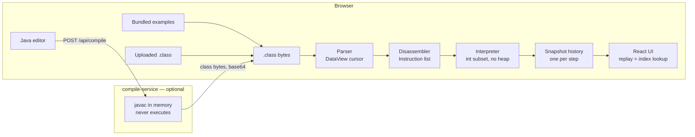

<!-- update OWNER/REPO after publishing -->

[](https://github.com/OWNER/REPO/actions/workflows/web.yml)
[](https://github.com/OWNER/REPO/actions/workflows/server.yml)
[](https://github.com/OWNER/REPO/actions/workflows/e2e.yml)

# JVM Bytecode Visualizer

A browser-based JVM bytecode visualizer: load a `.class` file or write Java, then watch the virtual
machine execute it one instruction at a time.


> Live demo: _coming soon_

## What it does

- **Three ways in.** Pick one of four bundled examples, upload your own `.class` file, or write Java
  in the browser and have it compiled (the last one needs the optional compile service).
- **Deterministic replay.** The whole run is recorded before anything is drawn, so play, pause, step
  forward, step back and scrubbing are all the same operation: an index into an array. Speeds run
  from 0.5x to 8x; space, arrow keys, Home and End drive the transport from the keyboard.
- **The machine state, panel by panel.** Source with the current line highlighted, the disassembly
  with the program counter, the call stack, the operand stack and the local variable slots — named
  from the `LocalVariableTable` when the class was compiled with `-g`.
- **Branch arcs.** Jump targets are drawn as arcs in the bytecode gutter, so a loop looks like a
  loop before you read a single offset.
- **A "next instruction" card.** For the instruction about to execute: its effect on the operand
  stack, a sentence about the concrete values it will touch, and — for instructions with a constant
  pool operand — the resolution chain, e.g. `#7 → Methodref → Factorial.factorial:(I)I`.
- **A depth chart under the scrubber.** Call stack depth across the entire run, which makes
  recursion visible as a shape you can click into.

## How it works

Everything that executes bytecode runs in the browser. A `.class` file is parsed from an
`ArrayBuffer` with a `DataView` cursor, disassembled into instructions, and then executed **ahead of
time** by an interpreter that records one immutable snapshot per step — the state _before_ each
instruction runs, closed by a terminal snapshot. The UI never executes anything; it reads
`history[index]`. Stepping backwards needs no undo logic because there is nothing to undo.

The optional Java compile service is the other half of the story, and it is deliberately boring: it
compiles source to bytecode in memory with `javax.tools.JavaCompiler` and returns the bytes. It
never loads a class, never starts a JVM for user code, never writes to disk. The compiled bytecode
executes on the client, in the same interpreter that handles uploads. That inversion — the server
compiles, the client executes — removes remote code execution from the threat model instead of
trying to sandbox it ([ADR-0003](docs/adr/0003-backend-compiles-never-executes.md)).



The domain layer (`web/src/core/`) is plain TypeScript with no React, no DOM and no dependency on
the application layer. That is not a convention, it is a lint rule — see
[Design decisions](#design-decisions).

## Correctness

The interpreter is the part that has to be right, so it is pinned from four directions.

- **Differential tests against a real JVM.** Each bundled example is compiled and then _run_ by
  `java` when the fixtures are built; the printed result is stored in `manifest.json` as
  `expectedResult`. The differential test executes the same class files in this interpreter and
  compares. If the interpreter drifts from the reference implementation, the test fails with the
  number that proves it.
- **Property-based tests (fast-check).** 32-bit `int` arithmetic is checked against a `BigInt`
  reference truncated to the low 32 bits — `iadd`, `isub`, `imul`, `idiv`, `irem`, `ineg`, including
  `INT_MIN / -1` and `INT_MIN % -1`. A plain `a * b` in JavaScript does not wrap at 32 bits, and
  these properties are what catches it. The parser gets the same treatment from the other side:
  fed random buffers, random tails and arbitrary truncations of a valid class file, it must fail
  with a typed `ClassFileError` and never with a raw `RangeError`.
- **javap parity.** The parser assertions are transcribed from `javap -v -p Factorial.class` and the
  disassembler assertions from `javap -c` — mnemonics, offsets, operands and resolved branch
  targets. The full javap dump is committed next to the fixture
  (`web/src/core/classfile/__fixtures__/Factorial.javap.txt`) so a reviewer can check the expected
  values without a JDK.
- **The rest of the pyramid.** Around 450 unit and component tests, plus a Playwright suite
  that replays a recursive program end to end, scrubs into the recursion, rejects a non-class file
  and keeps the app usable afterwards.

Coverage thresholds are enforced by CI rather than by review: `web/src/core/**` must stay at 90%
lines, branches and functions, configured in `web/vite.config.ts`.

## Scope and limitations

This is a teaching instrument for how a stack machine works, not a JVM. The scope is closed on
purpose so that what exists can be complete — see
[ADR-0002](docs/adr/0002-int-only-mvp-without-heap.md) for the reasoning and the exit path.

- **`int` only, no heap.** No objects, no arrays, no `long`/`float`/`double`, no `String` beyond the
  constant pool, no exceptions, no threads, no lambdas, no bytecode verification.
- **The executable instruction set** is constants, load/store, `iinc`, `dup`/`pop`, integer
  arithmetic, the `if<cond>`/`if_icmp<cond>` families, `goto`, and `invokestatic`/`ireturn`/`return`.
  `invokestatic` resolves within the current class only.
- **The parser is deliberately wider than the interpreter.** It reads the whole class file format —
  every constant pool tag, unknown attributes skipped by length — because a modern `javac` emits
  attributes that a narrow parser would choke on. An out-of-scope opcode is marked `unsupported`
  while _decoding_; only an attempt to _execute_ it stops the run, so a file with an unsupported
  instruction in dead code still replays.
- **Examples cannot print.** `System.out.println` needs `getstatic`, `invokevirtual` and the heap, so
  each example leaves its result in a local variable in `main` instead.
- **A step limit of 20,000** (raisable from the UI) stops runaway loops. The history collected up to
  that point stays playable, and so does the history up to a division by zero or an unsupported
  instruction.

## Tech stack

| Layer              | Choice                                                                                        |
| ------------------ | --------------------------------------------------------------------------------------------- |
| Frontend           | React 18, TypeScript (strict, `noUncheckedIndexedAccess`, `exactOptionalPropertyTypes`), Vite |
| Styling            | Tailwind CSS v4 (`@theme` tokens in `index.css`), framer-motion for value transitions         |
| Domain             | Plain TypeScript — parser, disassembler, interpreter, zero framework dependencies             |
| Backend (optional) | Java 21, Spring Boot 3, Maven                                                                 |
| Tests              | Vitest, Testing Library, fast-check, Playwright, JUnit 5, MockMvc                             |
| Tooling            | ESLint (typescript-eslint strict-type-checked), Prettier, GitHub Actions                      |

## Getting started

**Prerequisites:** Node ≥ 20.18.1 and npm ≥ 10. A JDK 21+ is needed only for the compile service and
for rebuilding fixtures — the example `.class` files are committed, so the frontend needs no Java at
all.

```bash
npm install
npm run dev          # http://localhost:5173
```

That is the whole application: examples and `.class` upload work with no backend
([ADR-0004](docs/adr/0004-backend-as-progressive-enhancement.md)).


### The optional compile service

The in-browser Java editor appears only when a compile service is configured and answers a health
check. In one terminal:

```bash
cd server
./mvnw spring-boot:run       # http://localhost:8080
```

In another, point the frontend at it and restart the dev server:

```bash
cp web/.env.example web/.env    # sets VITE_COMPILE_API_URL=http://localhost:8080
npm run dev
```

The variable is read at build time. Leave it unset and the editor tab simply does not exist — no
broken button, no error.

### Checks

```bash
npm run lint                 # ESLint, strict-type-checked
npm run typecheck            # tsc -b
npm test                     # Vitest: core + UI projects
npm run build                # production bundle
npm run test:coverage -w web # coverage, with the core thresholds enforced
npm run e2e -w web           # Playwright; builds and serves dist/ itself
cd server && ./mvnw verify   # JUnit + MockMvc
```

The first Playwright run needs a browser: `npx playwright install chromium`.

### Rebuilding the fixtures

```bash
npm run fixtures -w web
```

Requires a JDK 21+ on `PATH`. The script compiles the sources in `web/fixtures/src/` with
`javac -g --release 21`, runs each program on a real JVM to capture its result, and regenerates
`web/public/examples/` together with `manifest.json`. Those artifacts are committed, which is why CI
and deployment need no JDK.

## Design decisions

Architecture decision records live in [`docs/adr/`](docs/adr/), and
[`docs/architecture.md`](docs/architecture.md) goes deeper on the module map, the data flow and the
error taxonomy.

- [**ADR-0001 — Snapshot history instead of a live interpreter.**](docs/adr/0001-snapshot-history.md)
  Execute the whole program up front and return an immutable array of snapshots; the frontend
  replays it. Step-back and scrubbing become index arithmetic, and the interpreter stays a pure
  function that can be tested like one.
- [**ADR-0002 — MVP on `int` only, without a heap.**](docs/adr/0002-int-only-mvp-without-heap.md)
  A closed instruction set that can be implemented and tested completely, rather than a broad one
  that is right in patches.
- [**ADR-0003 — The backend compiles, it never executes user code.**](docs/adr/0003-backend-compiles-never-executes.md)
  Compilation happens in memory with `-proc:none`, an empty class path, a size cap, a timeout and
  rate limiting; execution happens in the user's own browser.
- [**ADR-0004 — The backend is progressive enhancement, not a dependency.**](docs/adr/0004-backend-as-progressive-enhancement.md)
  The demo, the local setup and the frontend CI all work with no server running.

The boundary from ADR-0001 is enforced mechanically. `web/eslint.config.js` bans imports of React,
the DOM and the application layer from `web/src/core/**`, and bans `window`, `document` and
`localStorage` there too. Dependencies flow UI → core, and a stray import fails the build rather
than a code review.

## Project structure

```
web/
  src/core/         pure TypeScript domain — no React, no DOM (lint-enforced)
    classfile/      ByteReader, parser, descriptors, typed ClassFileError
    disassembler/   full opcode table, decoding, branch targets
    interpreter/    execute() → snapshots, frames, 32-bit int arithmetic
  src/components/   panels, transport, branch gutter, depth chart
  src/services/     program building, app state machine, compile client
  fixtures/         example .java sources + the build script
  public/examples/  committed .class files and manifest.json
  tests/e2e/        Playwright specs
server/             Spring Boot compile service (Java 21)
docs/adr/           architecture decision records
```

## Roadmap

1. **Arrays and a heap** (`newarray`, `iaload`, `iastore`, `arraylength`) — which brings BubbleSort
   back as an example and gives the visualizer something to draw beside the stack.
2. **Objects and `invokevirtual`** — instance fields, `new`, `invokespecial`, and dynamic dispatch
   shown as it resolves.
3. **Exceptions** — `athrow` and the `exception_table`, with the stack unwinding on screen.
4. **Shareable links** — a program and a step index encoded in the URL, so a run can be linked to
   mid-execution.
5. **Other JVM languages** — Kotlin and Scala compile to the same bytecode; the constraint is the
   instruction set, not the source language.

## License

[MIT](LICENSE) — Copyright (c) 2026 Michał Błaszczykowski.
