# JVM Bytecode Visualizer

A browser-based JVM bytecode visualizer: load a `.class` file or write Java, then watch the virtual
machine execute it one instruction at a time.


## What it does

- Pick a bundled example, upload a `.class` file, or write Java in the browser (the last needs the
  optional compile service). Any valid class file opens. Whether it also replays depends on the
  instructions it uses, see [Scope and limitations](#scope-and-limitations).
- Explore the file: the constant pool cross-linked with the listing, so clicking `#7` in a comment
  lands on the entry it names; every declared method, including the ones no run enters; the class
  header, interfaces, fields and class file version.
- Deterministic replay. The whole run is recorded before anything is drawn, so play, pause, step
  forward, step back and scrubbing are one operation: an index into an array. Speeds 0.5x to 8x;
  space, arrow keys, Home and End drive the transport, `?` lists the rest. Step over and step out
  are there too, disabled when the history holds no such step.
- Panels for source with the current line, the disassembly with the program counter, the call stack,
  the operand stack, the local variable slots (named from the `LocalVariableTable` when compiled
  with `-g`), the heap and the console.
- Branch arcs in the bytecode gutter, drawn from each branch to its target.
- A "next instruction" card: stack effect, the concrete values it will touch, and for a constant
  pool operand the resolution chain, e.g. `#7 → Methodref → Factorial.factorial:(I)I`.
- A depth chart under the scrubber: call stack depth across the run, marked with calls, returns,
  taken branches, heap writes and printed lines.
- Value provenance. Every operand stack cell and local slot carries the step that produced it, and
  following it seeks the run there.
- Guided tours, one over the recursion in `Factorial` and one over the swap in `BubbleSort`. A tour
  is a short list of stops; each seeks the run to the step it names and says what to watch there.
- Deep links. `#/bubble-sort/248` addresses a step of a run, `#/bubble-sort/tour/the-swap/2` a tour
  stop. Only bundled examples are addressable, and an uploaded `.class` never leaves the tab.
- A glossary in the panel headers. [`docs/jvm-primer.md`](docs/jvm-primer.md) is the long form: the
  operand stack, frames, local slots, the constant pool and descriptors like `(I)I`, from scratch.


## Architecture

Everything that executes bytecode runs in the browser. A `.class` file is parsed from an
`ArrayBuffer` with a `DataView` cursor, disassembled into instructions, then executed ahead of time
by an interpreter that records one immutable snapshot per step. The UI never executes anything. It
reads `history[index]`, so stepping backwards needs no undo logic.

The optional compile service compiles source to bytecode in memory and returns the bytes. It never
loads a class, never runs what it compiled, never writes to disk, and javac runs in a short-lived
child JVM killed outright at the deadline. The compiled bytecode executes on the client, in the same
interpreter that handles uploads.

<picture>
  <source media="(prefers-color-scheme: dark)" srcset="docs/diagrams/pipeline-dark.svg">
  
</picture>

The domain layer (`web/src/core/`) is plain TypeScript: no React, no DOM, no dependency on the
application layer. A lint rule enforces it ([Design decisions](#design-decisions)).
[`docs/architecture.md`](docs/architecture.md) has the module map, the error taxonomy and the
measured cost of a long run.

## Correctness

The interpreter is the part that has to be right, so it is pinned from four directions: differential
tests whose expected stdout was captured from a real `java` at fixture build time, property-based
tests comparing 32-bit arithmetic against a `BigInt` reference and throwing random and truncated
buffers at the parser, parser and disassembler assertions transcribed from `javap -v -p` and
`javap -c`, and a corpus of 8,053 third-party class files parsed on every CI run. None of the
expected values was written by hand.

Under that: 1,607 unit and component tests across 89 files, a Playwright suite over the production
bundle, and coverage thresholds CI enforces per file. [`docs/architecture.md`](docs/architecture.md)
describes each layer.

## Scope and limitations

This is a teaching instrument for how a stack machine works. It implements part of the JVM, and the
scope is closed so that the part it implements can be complete.

The parser and the disassembler are measured against the real world; the interpreter is not.
`npm run corpus -w web` fetches ten libraries from Maven Central, pinned by SHA-1 and chosen so that
`javac`, `kotlinc` and `scalac` are all represented, the last two emitting shapes javac never does.
One of the ten is ASM, included because a library that writes class files is full of the format's
own corners. Their licences are Apache-2.0, MIT, EPL-2.0 and BSD-3-Clause; no jar or class file is
committed here, and the download directory is gitignored.

`npm run test:corpus -w web` puts every class file through the same parse → disassemble path the
application uses, on every change. The figures are committed to `web/corpus/scan.json` and the suite
fails if a scan disagrees with them:

| Over 10 jars from Maven Central       |                |
| ------------------------------------- | -------------- |
| Class files parsed                    | 8,053          |
| Failures                              | **0**          |
| Methods disassembled                  | 88,604         |
| Instructions decoded                  | 1,173,738      |
| Methods with an undecodable tail      | **0**          |
| Class file major versions encountered | 49, 51, 52, 53 |

Execution is the narrower claim, and the same corpus measures it. 91.5% of those 1.17 million
instructions are ones the interpreter implements, but a method replays only if _every_ instruction
in it runs, so the number that matters is counted per method: **65.2% of the 88,604 methods (57,734
of them) consist entirely of implemented instructions.**

The boundary is that **everything resolves inside the loaded class**. `new ArrayList<>()` stops on
the missing class file rather than a missing instruction, since `new` and `invokespecial` are both
implemented. A run also needs a static method it can enter, and only one of the 8,053 has a `main`.
A file that does not replay still opens, and a run that stops midway keeps what it recorded.

| In the Java source                                                                                                        | In the bytecode                                         | What the application does                                                                                                                                                                                             |
| ------------------------------------------------------------------------------------------------------------------------- | ------------------------------------------------------- | --------------------------------------------------------------------------------------------------------------------------------------------------------------------------------------------------------------------- |
| A type other than the one loaded: `new ArrayList<>()`, `throw new IllegalStateException(...)`, a second class of your own | `new`, `invokespecial`, `getfield` naming another class | Stops at the instruction that names it. Objects of the _loaded_ class work; there is no second class file to load.                                                                                                    |
| Static fields                                                                                                             | `putstatic`, `getstatic` outside the externals table    | Stops at the write. There is no class initialization and no static state.                                                                                                                                             |
| `long`, `float`, `double`                                                                                                 | `ladd`, `fmul`, `dload`, two-slot locals                | Stops at the first such instruction; a method taking one cannot be called.                                                                                                                                            |
| Lambdas, method references, `"a" + b`                                                                                     | `invokedynamic`                                         | Stops at the call site, which still reads like javap (`#0:makeConcatWithConstants:(...)`) and is labelled with the Java construct it came from. String concatenation compiles to `invokedynamic` on Java 9 and later. |
| Arrays of anything but `int`                                                                                              | `anewarray`, `multianewarray`, `baload`, …              | Stops at the allocation. The heap holds `int` arrays only.                                                                                                                                                            |
| Standard library calls beyond `Math` and `System.out`                                                                     | `invokestatic`/`invokevirtual` on another type          | Stops with `unsupported-call`. The recognized members are a table in `web/src/core/interpreter/externals.ts`; adding one is a row.                                                                                    |
| No static `main`: a utility class, an interface, an enum, a record, a nested class                                        | no entry point to run                                   | Opens in the explorer with no run attached: the listing, the pool and the class header are all still there to read.                                                                                                   |

Regardless of the file:

- The executable subset is 92 opcodes: the `int` arithmetic, loads and stores, the stack family, the
  branches and both switches, `new`, `newarray` and the field instructions, and the three `invoke`s
  that resolve inside the loaded class. `EXECUTABLE_OPCODES` in
  `web/src/core/interpreter/interpreter.ts` is the definitive list, and the welcome screen states it
  at runtime so it cannot drift.
- Decoding is wider than execution, and parsing is wider still. `getfield #3` reads as
  `getfield #3 // Field Counter.value:I` in a class that never runs, and the pool panel cross-links
  every tag JVMS §4.4 defines.
- `try`/`catch` catches what the machine raises. Matching follows the class hierarchy, so all four
  kinds are caught by `catch (Exception e)`, and `finally` works because javac compiles it to a
  catch-all row. An exception of your own still needs a second class file.
- A step limit of 20,000, raisable from the UI, stops runaway loops; where the raise stops comes
  from `navigator.deviceMemory` (the arithmetic is in
  [`docs/architecture.md`](docs/architecture.md#what-a-long-run-costs)). Long listings are not
  windowed: every row of the Bytecode, constant pool and Source panels is in the DOM. The bundled
  examples are far too small for that to show, but a 512 KiB upload can carry a 65,534-entry pool.

[`docs/jvm-primer.md`](docs/jvm-primer.md) explains the machine the bundled examples run on.

## Tech stack

| Layer              | Choice                                                                                                                         |
| ------------------ | ------------------------------------------------------------------------------------------------------------------------------ |
| Frontend           | React 18, TypeScript (strict, `noUncheckedIndexedAccess`, `exactOptionalPropertyTypes`), Vite                                  |
| Frontend build     | The React Compiler (`babel-plugin-react-compiler`, `target: '18'`) over every component, with `react-compiler-runtime` shipped |
| Styling            | Tailwind CSS v4 (`@theme` tokens in `index.css`), framer-motion for the four animated surfaces                                 |
| Domain             | Plain TypeScript: parser, disassembler, interpreter, zero framework dependencies                                               |
| Application layer  | zod, which parses every compile-service response before it becomes a domain value                                              |
| Backend (optional) | Java 21, Spring Boot 3, Maven                                                                                                  |
| Tests              | Vitest, Testing Library, fast-check, Playwright, JUnit 5, MockMvc                                                              |
| Tooling            | ESLint (typescript-eslint strict-type-checked), Prettier, GitHub Actions                                                       |

## Getting started

Node ≥ 20.18.1 and npm ≥ 10. The example `.class` files are committed, so the frontend needs no Java
at all. Java is needed for two separate things, and they want different JDKs: the compile service
builds and runs on JDK 21, and rebuilding the fixtures requires JDK 25 exactly.

```bash
npm install
npm run dev          # http://localhost:5173
```

That is the whole application: examples and `.class` upload work with no backend.


### The optional compile service

The in-browser Java editor appears only when a compile service is configured and answers a health
check. Run the server in one terminal, point the frontend at it in another, and restart the dev
server:

```bash
cd server && ./mvnw spring-boot:run       # http://localhost:8080

cp web/.env.example web/.env              # sets VITE_COMPILE_API_URL=http://localhost:8080
npm run dev
```

The variable is read at build time. Leave it unset and the editor tab does not exist.

### Checks

```bash
npm run lint                 # ESLint, strict-type-checked
npm run typecheck            # tsc -b
npm test                     # Vitest: core + UI projects
npm run build                # production bundle
npm run test:coverage -w web # coverage, with the core thresholds enforced
npm run e2e -w web           # Playwright; builds and serves dist/ itself
npm run size -w web          # gzipped bundle budgets
cd server && ./mvnw verify   # JUnit + MockMvc
```

The first Playwright run needs a browser: `npx playwright install chromium`.

### Rebuilding the fixtures and the screenshots

```bash
npm run fixtures -w web       # needs JDK 25.0.4 exactly, since CI byte-diffs the javap dumps
npm run screenshots -w web
```

## Deployment

The frontend is a static bundle, the compile service is a container, and the two deploy
independently. [`docs/deployment.md`](docs/deployment.md) covers Vercel for the frontend and Fly.io
for the server, and lists the placeholders to fill in.

`?embed` puts the application in embedded mode: the toolbar becomes the name of what is loaded plus
a way out to the full application, and the frame shows one run. The flag is a query parameter and
the moment is a hash, so the two compose.

```html
<iframe
  src="https://your-deployment/?embed#/bubble-sort/tour/the-swap/2"
  width="1100"
  height="700"
  title="A swap, one instruction at a time"
  loading="lazy"
></iframe>
```

Anything from about 1000×640 gets all three panels; below that the State column folds into a band
under the code. An embed that names no program loads the first example.

## Design decisions

The interface is flat and separated by hairlines rather than by shadow. The accent means "the
machine is here now" and nothing else. Both palettes come from one set of tokens written as
`light-dark()` pairs, and `web/eslint.config.js` fails the build on an ad-hoc grey, an undeclared
radius or a one-off spacing value.


The same config enforces the domain boundary: dependencies flow UI → core, and a stray import fails
the build. [`docs/architecture.md`](docs/architecture.md) states the rule in full.

## What would come next

Loading a second class file. It is the limit an uploaded file hits most often, and the one
`invokeinterface` is waiting on. Nothing already built for objects would have to change.


## License

[MIT](LICENSE), Copyright (c) 2026 Michał Błaszczykowski.
