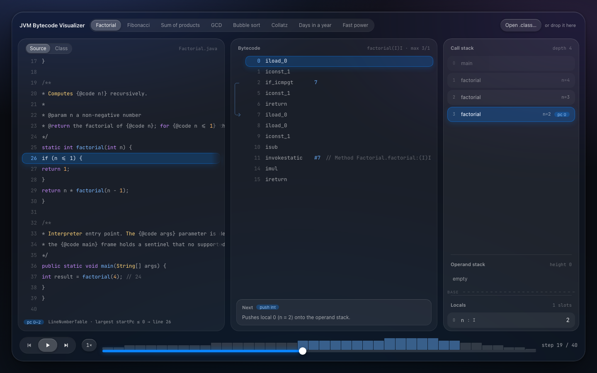
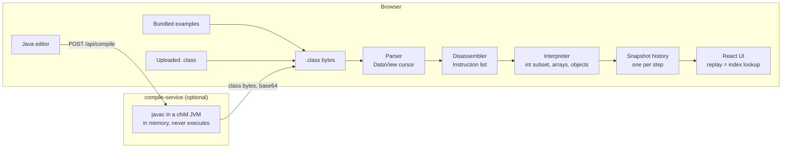
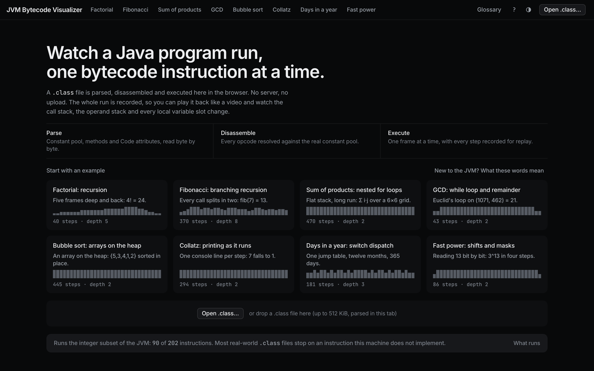
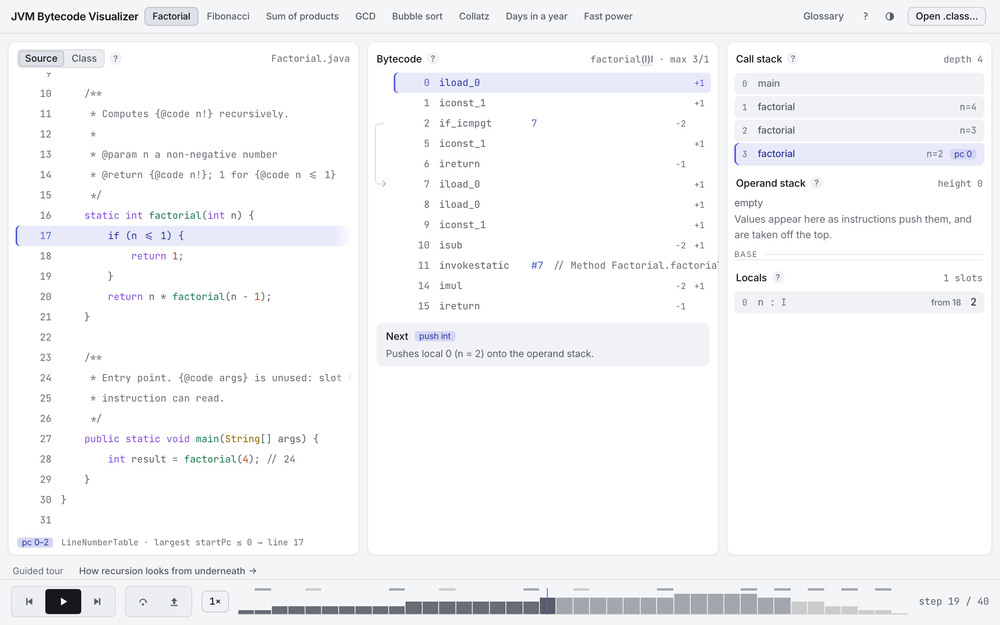

# JVM Bytecode Visualizer

A browser-based JVM bytecode visualizer: load a `.class` file or write Java, then watch the virtual
machine execute it one instruction at a time.

> Not deployed yet, so there is no link to click. `npm install && npm run dev` is the whole setup,
> and [`docs/deployment.md`](docs/deployment.md) covers what a deploy would need.



## What it does

- Pick a bundled example, upload a `.class` file, or write Java in the browser (the last needs the
  optional compile service). Any valid class file opens; whether it also replays depends on the
  instructions it uses, see [Scope and limitations](#scope-and-limitations).
- Explore the file: the constant pool cross-linked with the listing, so clicking `#7` in a comment
  lands on the entry it names; every declared method, including the ones no run enters; the class
  header, interfaces, fields and class file version.
- Deterministic replay. The whole run is recorded before anything is drawn, so play, pause, step
  forward, step back and scrubbing are one operation: an index into an array. Speeds 0.5x to 8x;
  space, arrow keys, Home and End drive the transport, `?` lists the rest.
- Step over to the next step no deeper than this one, step out to the step at which the current frame
  has returned. With no such step in the history the control is disabled.
- Panels for source with the current line, the disassembly with the program counter, the call stack,
  the operand stack, the local variable slots (named from the `LocalVariableTable` when compiled with
  `-g`), the heap and the console.
- Branch arcs in the bytecode gutter, so a loop looks like a loop before you read an offset.
- A "next instruction" card: stack effect, the concrete values it will touch, and for a constant pool
  operand the resolution chain, e.g. `#7 → Methodref → Factorial.factorial:(I)I`.
- A depth chart under the scrubber: call stack depth across the run, marked with calls, returns,
  taken branches, heap writes and printed lines.
- Value provenance. Every operand stack cell and local slot carries the step that produced it, and
  following it seeks the run there.
- Deep links. `#/bubble-sort/248` addresses a step of a run; only bundled examples are addressable,
  and an uploaded `.class` never leaves the tab.
- A glossary in the panel headers. [`docs/jvm-primer.md`](docs/jvm-primer.md) is the long form: the
  operand stack, frames, local slots, the constant pool and descriptors like `(I)I`, from scratch.


## Architecture

Everything that executes bytecode runs in the browser. A `.class` file is parsed from an
`ArrayBuffer` with a `DataView` cursor, disassembled into instructions, then executed ahead of time
by an interpreter that records one immutable snapshot per step: the state _before_ each instruction
runs, closed by a terminal snapshot. The UI never executes anything, it reads `history[index]`, so
stepping backwards needs no undo logic.

The optional compile service compiles source to bytecode in memory with `javax.tools.JavaCompiler`
and returns the bytes. It never loads a class, never runs what it compiled, never writes to disk, and
javac runs in a short-lived child JVM killed outright at the deadline. The compiled bytecode executes
on the client, in the same interpreter that handles uploads, so remote code execution stays out of
the threat model ([ADR-0003](docs/adr/0003-backend-compiles-never-executes.md)).



The domain layer (`web/src/core/`) is plain TypeScript: no React, no DOM, no dependency on the
application layer. A lint rule enforces it ([Design decisions](#design-decisions)).

## Correctness

The interpreter is the part that has to be right, so it is pinned from four directions.

- Differential tests against a real JVM. Each bundled example is compiled and run by `java` when the
  fixtures are built, and its printed result stored in `manifest.json` as `expectedResult`. The
  awkward corners of the instruction set get their own programs under
  `web/src/core/interpreter/__fixtures__/programs/`, with stdout captured from a real `java` and
  committed line for line: shifts at distances 0–35 across both `int` boundaries, `tableswitch` and
  `lookupswitch` including fall-through, every pair from a nine-value set through
  `Math.max`/`min`/`abs`/`floorDiv`/`floorMod`, and every `print`/`println` overload. No expectation
  in those files was written by hand.
- Property-based tests (fast-check). 32-bit `int` arithmetic against a `BigInt` reference truncated
  to the low 32 bits: `iadd`, `isub`, `imul`, `idiv`, `irem`, `ineg`, the shifts and their five-bit
  distance masking, the bitwise operations, the `i2b`/`i2c`/`i2s` narrowings, `INT_MIN / -1` and
  `INT_MIN % -1`. A plain `a * b` in JavaScript does not wrap at 32 bits. Fed random buffers, random
  tails and arbitrary truncations of a valid class file, the parser must fail with a typed
  `ClassFileError` and never a raw `RangeError`.
- javap parity. Parser assertions are transcribed from `javap -v -p Factorial.class`, disassembler
  assertions from `javap -c`: mnemonics, offsets, operands, resolved branch targets, and the jump
  tables of both switch instructions compared against javap's own arms. The full dump is committed
  next to the fixture (`web/src/core/classfile/__fixtures__/Factorial.javap.txt`), so a reviewer
  needs no JDK.
- A corpus of third-party code. 8,053 class files from ten Maven Central libraries, built by `javac`,
  `kotlinc` and `scalac`, parsed and disassembled with zero failures on every CI run. Its figures are
  committed to `web/corpus/scan.json` and the suite fails if a scan disagrees with them. It also
  measures the interpreter's reach; see [Scope and limitations](#scope-and-limitations).

Under that: 1,402 unit and component tests across 79 files, a Playwright suite that replays a
recursive program end to end, scrubs into the recursion, checks that the interpreter really runs in a
worker, opens a class with no entry point in the explorer and rejects a non-class file, and a second
end-to-end job running the editor against the compile service built from its own Dockerfile. Two more
specs guard the accessibility tree and the design system: `web/tests/e2e/a11y.spec.ts` runs axe at
`moderate` and above over several states in both palettes, and `web/tests/e2e/theme.spec.ts` measures
AA contrast for the text steps against the surfaces in both palettes and checks that every
`--color-*` token the stylesheet declares resolves. Coverage thresholds are CI-enforced: `web/src/core/**` must stay at 90% lines, branches and
functions, measured per file rather than in aggregate, in `web/vite.config.ts`. The server has its own
gate in `server/pom.xml`: 0.85 line and 0.75 branch coverage per package on `api`, `compiler`, `config`
and `service`, against 101 tests, which today sit at 95.7/81.8, 87.6/82.8, 92.8/85.2 and 96.9/85.7.

## Performance

Recording every step is what this design pays for its replay, so the cost is measured. The structural
counts are budgets that fail a build when they move; the throughput figure is a one-off measurement.

- ~600,000 steps a second: a 20,007-step counting loop parsed, disassembled, executed and recorded in
  33 ms. Measured under Node 20 on one core with `vitest`, on a development machine rather than a
  benchmark rig, so it catches an order of magnitude and is not comparable to a JIT.
- A frame is copied once per change rather than once per step it survives. Two hundred nested calls
  produce 1,408 snapshots holding 1,608 frozen frames, where copying the whole call stack per step
  would produce 142,911: 88.9× fewer. That reuse is what makes
  [ADR-0001](docs/adr/0001-snapshot-history.md) affordable, and
  `web/src/core/interpreter/performance.test.ts` pins all three counts exactly, so a change to the
  sharing shows up as a diff.
- The history has a ceiling: 8M live heap elements and 24M recorded ones, both surfaced as
  `OutOfMemoryError` exactly as a real JVM would, so a program that asks for more stops with its
  history intact. The recording ceiling is shared by the heap, the console and the external objects,
  so a print-heavy run reaches it too, as does a loop that throws: each throw allocates its own
  exception object, so two catches of the same kind never see the same one.
- So does the bundle. `npm run size -w web` fails when a shipped chunk outgrows its gzipped budget or
  a static asset outgrows its raw one, and CI runs it after the build.

```
✓ index.js                  100.0 kB gzip / 108 kB  the application itself
✓ react.js                   42.2 kB gzip /  48 kB  react + react-dom
✓ motion.js                  44.1 kB gzip /  50 kB  framer-motion
✓ index.css                   8.5 kB gzip /  14 kB  the whole stylesheet
✓ run-program.worker.js      12.4 kB gzip /  16 kB  parser + interpreter
✓ og-image.jpg              134.8 kB raw  / 160 kB  the social card
✓ favicon.svg                 0.7 kB raw  /   4 kB  the tab icon
```

The `index.js` budget went from 95 kB to 108 kB while the bundle grew about 9.5 kB, to the 100.0 kB
above, which leaves 8 kB of headroom. What the application carries beyond the parser and the
disassembler: an explanation for every opcode in the executable subset, full constant pool resolution
so every tag renders and cross-links, the glossary, the compile service's error copy, and the shared
button and dialog primitives.

Timing on a shared CI runner is not evidence, so no test asserts a duration.
`web/src/core/interpreter/performance.test.ts` asserts counts: how many snapshots a run produces, how
many frame objects those snapshots share, and that a flat run costs one frame per step.

## Deployment

The frontend is a static bundle and the compile service is a container, so the two deploy
independently. [`docs/deployment.md`](docs/deployment.md) covers Vercel for the frontend and Fly.io
for the server, and lists the placeholders to fill in.

### Crash reporting

`web/src/services/telemetry.ts` is one function, one payload type and one endpoint, off unless
`VITE_TELEMETRY_URL` is set. An uploaded `.class` never leaves the tab, and a crash report is the
sort of thing that quietly breaks such a promise, so the payload is a closed union of scalars: no
field a class file, a line of source or a pool string can be put in, and a test reads the bytes
actually put on the wire. Reports stay actionable regardless, because runs are deterministic
(ADR-0001): for a bundled example an id and a step index reproduce the state that broke.

### Embedding a run

`?embed` puts the application in embedded mode: the toolbar becomes the name of what is loaded plus a
way out to the full application, and the frame shows one run. The flag is a query parameter and the
moment is a hash, so the two compose.

```html
<iframe
  src="https://your-deployment/?embed#/bubble-sort/tour/the-swap/2"
  width="1100"
  height="700"
  title="A swap, one instruction at a time"
  loading="lazy"
></iframe>
```

Anything from about 1000×640 gets all three panels; below that the State column folds into a band
under the code, as on a tablet, and a short frame costs rows of the listing. An embed that names no
program loads the first example, since a frame in someone else's page should not show a chooser.

## Scope and limitations

This is a teaching instrument for how a stack machine works. It implements part of the JVM, and the
scope is closed so that the part it implements can be complete.
[ADR-0002](docs/adr/0002-int-only-mvp-without-heap.md) has the reasoning and the exit path, and
[ADR-0005](docs/adr/0005-heap-of-int-arrays.md), [ADR-0007](docs/adr/0007-exceptions-without-an-object-model.md)
and [ADR-0008](docs/adr/0008-objects-of-the-loaded-class.md) record where the boundary moved to.

The parser and the disassembler are measured against the real world; the interpreter is not.
`npm run corpus -w web` fetches ten libraries from Maven Central, pinned by SHA-1 and chosen so that
three compilers are represented: `javac`, `kotlinc` and `scalac`, the last two emitting shapes javac
never does. One of the ten is ASM, a bytecode library compiled by javac like the rest, included
because a library that writes class files is full of the format's own corners.

`npm run test:corpus -w web` puts every class file through the same parse → disassemble path the
application uses, on every change. The figures are committed to `web/corpus/scan.json` and the suite
fails if a scan disagrees with them, so the numbers below are checked on every run:

| Over 10 jars from Maven Central       |                |
| ------------------------------------- | -------------- |
| Class files parsed                    | 8,053          |
| Failures                              | **0**          |
| Methods disassembled                  | 88,604         |
| Instructions decoded                  | 1,173,738      |
| Methods with an undecodable tail      | **0**          |
| Class file major versions encountered | 49, 51, 52, 53 |

The versions are Java 5, 7, 8 and 9. There is no major 50 in the set, so the range is not
contiguous, and nothing here is compiled for Java 17.

Execution is the narrower claim, and the same corpus measures it. 91.5% of those 1.17 million
instructions are ones the interpreter implements, but a method replays only if _every_ instruction in
it runs, so the number that matters is counted per method: **65.2% of the 88,604 methods (57,734 of
them) consist entirely of implemented instructions.**

The most common instruction still outside the subset is `invokeinterface`, and behind it sit the
things a second class file would be needed for. The boundary: **everything resolves inside the
uploaded class.** Its own objects, constructors, instance methods and fields all run.
`new ArrayList<>()` and `throw new IllegalStateException(...)` stop, and what stops them is the
missing class file rather than a missing instruction: `new` and `invokespecial` are both implemented.

A separate limit decides whether a file replays at all: a run needs a static method it can enter, and
only one of the 8,053 has a `main`, which is why the explorer matters as much as the transport. A
file that does not replay still opens: parsing, the constant pool, the method table and the full
listing do not depend on execution, and a run that stops midway keeps the history it recorded.

| In the Java source                                                                                                        | In the bytecode                                         | What the application does                                                                                                                                                                                             |
| ------------------------------------------------------------------------------------------------------------------------- | ------------------------------------------------------- | --------------------------------------------------------------------------------------------------------------------------------------------------------------------------------------------------------------------- |
| A type other than the one loaded: `new ArrayList<>()`, `throw new IllegalStateException(...)`, a second class of your own | `new`, `invokespecial`, `getfield` naming another class | Stops at the instruction that names it. Objects of the _loaded_ class work; there is no second class file to load.                                                                                                    |
| Static fields                                                                                                             | `putstatic`, `getstatic` outside the externals table    | Stops at the write. There is no class initialisation and no static state.                                                                                                                                             |
| `long`, `float`, `double`                                                                                                 | `ladd`, `fmul`, `dload`, two-slot locals                | Stops at the first such instruction; a method taking one cannot be called.                                                                                                                                            |
| Lambdas, method references, `"a" + b`                                                                                     | `invokedynamic`                                         | Stops at the call site, which still reads like javap (`#0:makeConcatWithConstants:(...)`) and is labelled with the Java construct it came from. String concatenation compiles to `invokedynamic` on Java 9 and later. |
| Arrays of anything but `int`                                                                                              | `anewarray`, `multianewarray`, `baload`, …              | Stops at the allocation. The heap holds `int` arrays only.                                                                                                                                                            |
| Standard library calls beyond `Math` and `System.out`                                                                     | `invokestatic`/`invokevirtual` on another type          | Stops with `unsupported-call`. The recognised members are a table in `web/src/core/interpreter/externals.ts`; adding one is a row.                                                                                    |
| No static `main`: a utility class, an interface, an enum, a record, a nested class                                        | no entry point to run                                   | Opens in the explorer with no run attached: the listing, the pool and the class header are all still there to read.                                                                                                   |

The parts that hold regardless of which file is loaded:

- A single-class machine: `int` values, `int` arrays and instances of the one class in the file, on a
  small heap, plus opaque tokens for the few external members it recognises. No
  `long`/`float`/`double`, no second class file, no inheritance beyond `Object`, no interfaces, no
  static state, no threads, no lambdas, no bytecode verification.
- The executable subset is 92 opcodes. `EXECUTABLE_OPCODES` in
  `web/src/core/interpreter/interpreter.ts` is the definitive list, built from the `Op` table the
  dispatch switch uses, and the welcome screen states it at runtime so it cannot drift. Grouped as
  JVMS §6.5 lays them out:
  - constants: `nop`, `aconst_null`, `iconst_m1` through `iconst_5`, `bipush`, `sipush`, `ldc`,
    `ldc_w`
  - loads and stores: `iload`, `aload` and their `_0`–`_3` forms, `istore`, `astore` and theirs,
    `iaload`, `iastore`, `iinc`
  - stack: the whole family, `pop`, `pop2`, `dup`, `dup_x1`, `dup_x2`, `dup2`, `dup2_x1`, `dup2_x2`
    and `swap`, since every value this machine holds occupies one slot
  - arithmetic: `iadd`, `isub`, `imul`, `idiv`, `irem`, `ineg`, the shifts `ishl`/`ishr`/`iushr`,
    the bitwise `iand`/`ior`/`ixor`, and the `i2b`/`i2c`/`i2s` narrowings
  - control flow: the `if<cond>`, `if_icmp<cond>` and `if_acmp<cond>` families, `ifnull`,
    `ifnonnull`, `goto`, `tableswitch`, `lookupswitch`, `ireturn`, `areturn`, `return`, `athrow`
  - objects and fields: `new`, `newarray`, `arraylength`, `getstatic`, `getfield`, `putfield`
  - calls: `invokestatic`, `invokespecial`, `invokevirtual`, resolving within the class being
    executed plus the members on the externals table (`java/lang/Math` and `System.out`)

  `wide` is not in that list because it is folded into the instruction it widens at decode time,
  which is the representation javap prints. `putstatic` is not in it either; see the static fields
  row above.

- Objects of the loaded class run: `new`, the constructor, instance methods and instance fields.
  Shape is fixed at allocation from the class's own field table, each field starts at its
  descriptor's default, and the heap panel draws the fields by name as the run writes them. A null
  reference at `getfield`, `putfield`, `invokevirtual` or `athrow` raises `NullPointerException` the
  way a real JVM does ([ADR-0008](docs/adr/0008-objects-of-the-loaded-class.md)).
- Decoding is wider than execution: every assigned opcode below `0xca` is fully decoded (mnemonic,
  operands, branch targets, switch tables) whether or not the interpreter runs it, so `getfield #3`
  reads as `getfield #3 // Field Counter.value:I` in a class that never executes. Decoding stops only
  at bytes with no instruction boundary after them.
- The parser is wider still, and a class the machine cannot execute still reads completely. Every
  constant pool tag JVMS §4.4 defines is parsed into typed indices and values and every one of them
  renders, so the pool panel cross-links `InterfaceMethodref`, `MethodHandle`, `MethodType`,
  `Dynamic`, `InvokeDynamic`, `Module` and `Package`, and prints `Float`, `Long` and `Double` values
  with javap's `f`/`l`/`d` suffixes. Unknown attributes are skipped by length, because a modern
  `javac` emits attributes a narrow parser would choke on. Overlong modified-UTF-8 is rejected the
  way a real class loader rejects it.
- `try`/`catch` catches what the machine raises: `ArithmeticException`,
  `ArrayIndexOutOfBoundsException`, `NullPointerException`, `NegativeArraySizeException`. The
  `exception_table` is read, `athrow` runs, and a thrown exception unwinds the call stack one visible
  step at a time looking for a handler. Matching follows the class hierarchy, so all four are caught
  by `catch (Exception e)`, and `finally` works because javac compiles it to a catch-all row. An
  exception of your own still needs `new`
  ([ADR-0007](docs/adr/0007-exceptions-without-an-object-model.md)).
- A stopped run is still a run: what was recorded stays loaded and scrubbable, and the banner names
  the instruction and the offset that stopped it.
- Most bundled examples leave their result in a local variable in `main` instead of printing it,
  which is easier to watch than a printed line. Collatz is the exception, and it is what the Console
  panel is there for.
- A step limit of 20,000, raisable from the UI, stops runaway loops; the history up to it stays
  playable, as does the history up to a division by zero or an unsupported instruction. A browser
  that reports how much memory it has gets a ceiling it can actually hold.
- Two bounds on memory, both reported as `OutOfMemoryError` as a real JVM would: the heap, so
  `new int[Integer.MAX_VALUE]` stops at the allocation; and the recording, since every step that
  writes to an array keeps its own immutable copy, so a large array written in a loop costs far more
  history than the array does. Both leave the run playable up to where they stopped it.

[`docs/jvm-primer.md`](docs/jvm-primer.md) explains the machine the bundled examples run on.

## Tech stack

| Layer              | Choice                                                                                        |
| ------------------ | --------------------------------------------------------------------------------------------- |
| Frontend           | React 18, TypeScript (strict, `noUncheckedIndexedAccess`, `exactOptionalPropertyTypes`), Vite |
| Styling            | Tailwind CSS v4 (`@theme` tokens in `index.css`), framer-motion for value transitions         |
| Domain             | Plain TypeScript: parser, disassembler, interpreter, zero framework dependencies              |
| Backend (optional) | Java 21, Spring Boot 3, Maven                                                                 |
| Tests              | Vitest, Testing Library, fast-check, Playwright, JUnit 5, MockMvc                             |
| Tooling            | ESLint (typescript-eslint strict-type-checked), Prettier, GitHub Actions                      |

## Getting started

Node ≥ 20.18.1 and npm ≥ 10. The example `.class` files are committed, so the frontend needs no Java
at all. Java is needed for two separate things, and they want different JDKs: the compile service
builds and runs on JDK 21, and rebuilding the fixtures requires JDK 25 exactly (see
[Rebuilding the fixtures](#rebuilding-the-fixtures)).

```bash
npm install
npm run dev          # http://localhost:5173
```

That is the whole application: examples and `.class` upload work with no backend
([ADR-0004](docs/adr/0004-backend-as-progressive-enhancement.md)).



### The optional compile service

The in-browser Java editor appears only when a compile service is configured and answers a health
check. In one terminal:

```bash
cd server
./mvnw spring-boot:run       # http://localhost:8080
```

In another, point the frontend at it and restart the dev server:

```bash
cp web/.env.example web/.env    # sets VITE_COMPILE_API_URL=http://localhost:8080
npm run dev
```

The variable is read at build time. Leave it unset and the editor tab does not exist.

### Checks

```bash
npm run lint                 # ESLint, strict-type-checked
npm run typecheck            # tsc -b
npm test                     # Vitest: core + UI projects
npm run build                # production bundle
npm run test:coverage -w web # coverage, with the core thresholds enforced
npm run e2e -w web           # Playwright; builds and serves dist/ itself
cd server && ./mvnw verify   # JUnit + MockMvc
```

The first Playwright run needs a browser: `npx playwright install chromium`.

### Rebuilding the fixtures

```bash
npm run fixtures -w web
```

Requires **JDK 25** on `PATH`, and refuses to run on anything else: the builders check that both
`javac` and `javap` report feature version 25 and stop with an explanation if they do not. The class
files still target Java 21 (`--release 21`, major version 65), so the bytecode does not depend on the
JDK that produced it. The pin is about reproducibility: the `.class` files and the `javap` dumps are
committed and byte-diffed by CI, and javap's disassembly layout, which the builders parse back,
changed between releases.

The script compiles the sources in `web/fixtures/src/` with `javac -g --release 21`, runs each
program on a real JVM to capture its result, and regenerates `web/public/examples/` together with
`manifest.json`. Those artifacts are committed, which is why everything except this one command needs
no JDK. Moving to a different JDK means regenerating every fixture with it, committing the result,
and raising `REQUIRED_JDK_FEATURE` in `web/fixtures/jdk.mjs` and the fixtures job in
`.github/workflows/web.yml`.

### Regenerating the screenshots

```bash
npm run screenshots -w web
```

Builds the app, serves `dist/`, and drives Chromium through six states: the five shots in this README
and the error banner in [`docs/architecture.md`](docs/architecture.md). Four are addressed by deep
link, the welcome screen loads `/`, and the error banner comes from uploading a file that is not a
class, so the same command reproduces the same images. Run it after any visual change, so the README
never describes an interface that no longer exists.

## Design decisions

The interface is flat and separated by hairlines rather than by shadow, on four text steps, six
radii, and a single spacing scale. The accent means "the machine is here now" and nothing else:
selection is drawn from the surface ramp and progress from the foreground ramp, so the one colour
that says where execution is has no competition. A tinted surface uses one of four declared wash and
fill tokens, which replaced nineteen ad-hoc alpha tints. Both palettes come from one set of tokens
written as `light-dark()` pairs, and `web/eslint.config.js` fails the build on the ad-hoc greys,
undeclared radii, alpha-tinted surfaces and one-off spacing values that the design replaced.



Architecture decision records live in [`docs/adr/`](docs/adr/), and
[`docs/architecture.md`](docs/architecture.md) goes deeper on the module map, the data flow and the
error taxonomy.

- [ADR-0001: Snapshot history instead of a live interpreter](docs/adr/0001-snapshot-history.md).
  Execute up front, return an immutable array of snapshots, replay it in the frontend. Step-back and
  scrubbing become index arithmetic. Amended by ADR-0006 for where the run happens.
- [ADR-0002: MVP on `int` only, without a heap](docs/adr/0002-int-only-mvp-without-heap.md). A closed
  instruction set that can be tested completely, in preference to a broad one that is right in
  patches.
  Amended by ADR-0005 for the heap.
- [ADR-0003: The backend compiles, it never executes user code](docs/adr/0003-backend-compiles-never-executes.md).
  In memory with `-proc:none`, an empty class path and a size cap, inside a child JVM killed at the
  deadline and rationed by a bounded pool and a per-IP rate limit.
- [ADR-0004: The backend is progressive enhancement](docs/adr/0004-backend-as-progressive-enhancement.md).
  The demo, the local setup and the frontend CI all work with no server running.
- [ADR-0005: A heap that holds `int` arrays and nothing else](docs/adr/0005-heap-of-int-arrays.md).
  Arrays on an append-only heap, references as handles, and a kind tag per value so the machine
  refuses to read one as the other.
- [ADR-0006: Execution in a worker, and the history streamed back in batches](docs/adr/0006-execution-in-a-worker.md).
  A worker that posts a 500,000-step history as one message is six times _worse_ than no worker,
  because deserialising it lands on the thread the worker was meant to free. Batching drops the
  longest main-thread stall from 403 ms to ~120 ms.
- [ADR-0007: Exceptions the machine raises, caught without an object model](docs/adr/0007-exceptions-without-an-object-model.md).
  The exceptions a learner meets are raised by the JVM, not constructed in their code, so catching is
  the half that needs no constructor.
- [ADR-0008: Objects, of the loaded class and no other](docs/adr/0008-objects-of-the-loaded-class.md).
  The corpus measurement chose this over `long`/`double`: three of the four most common instructions
  the interpreter could not run were one feature.

- [ADR-0009: One table for an instruction's metadata](docs/adr/0009-one-table-for-opcode-metadata.md).
  The explanation, the pushed kind, the frame effect and the varying stack delta live in one row per
  opcode, with a test over `EXECUTABLE_OPCODES` that fails the build if a row is missing.
- [ADR-0010: Security headers for the published page](docs/adr/0010-security-headers-for-the-page.md).
  What each CSP directive is for, why `frame-ancestors *` is open, and what the sha256 in
  `script-src` is pinned to.

`web/eslint.config.js` enforces the ADR-0001 boundary: no imports of React, the DOM or the
application layer from `web/src/core/**`, and no `window`, `document` or `localStorage` there. The
import half of that rule now covers `web/src/services/**` and `web/src/workers/**` too, which may not
reach back into `components/` or `hooks/`. The globals half stays scoped to `core/`, because deep
links, the theme, telemetry and embed detection legitimately read the browser. Dependencies flow
UI → core, and a stray import fails the build.

## Project structure

```
web/
  src/core/         pure TypeScript domain, no React, no DOM (lint-enforced)
    classfile/      ByteReader, parser, descriptors, typed ClassFileError
    disassembler/   full opcode table, decoding, branch targets, switch tables
    interpreter/    execute() → snapshots, frames, int32, heap, external members
  src/workers/      the run off the main thread, streamed back in batches
  src/components/   panels, transport, branch gutter, depth chart, constant pool
  src/hooks/        the player, row navigation, scroll follow, dialog focus
  src/services/     program building, app state machine, derivations, compile client
  corpus/           the Maven Central fetch script and the committed scan
  fixtures/         example .java sources + the build scripts
  public/examples/  committed .class files and manifest.json
  tests/e2e/        Playwright specs
server/             Spring Boot compile service (Java 21)
docs/adr/           architecture decision records
```

## Roadmap

Ordered by how often an uploaded file runs into them, which is a different order from how easy they
are to build.

1. Arguments for the method a run starts from. `ExecuteOptions` names an entry method but has no
   channel for argument values, so a static `int` method that takes parameters is listed and marked
   but not offered. `notRunnableReasonOf` in `web/src/services/program.ts` is the one place that
   has to change.
2. A second class file, the limit that now decides most outcomes. Loading a class by name would let
   `new` and the call instructions resolve against something other than the file in front of them,
   which is what `new ArrayList<>()`, `throw new MyException()` and interface dispatch are waiting
   on. ADR-0008 records why nothing built for objects has to change for it.
3. Other JVM languages. Kotlin and Scala compile to the same bytecode and the corpus already parses
   both standard libraries; the constraint is the instruction set, not the source language.

Done, and described above instead of here: arrays on a small heap, shifts and bitwise operations,
`switch`, `System.out.println`, the static `Math` methods, the explorer, and shareable links.


## License

[MIT](LICENSE), Copyright (c) 2026 Michał Błaszczykowski.
