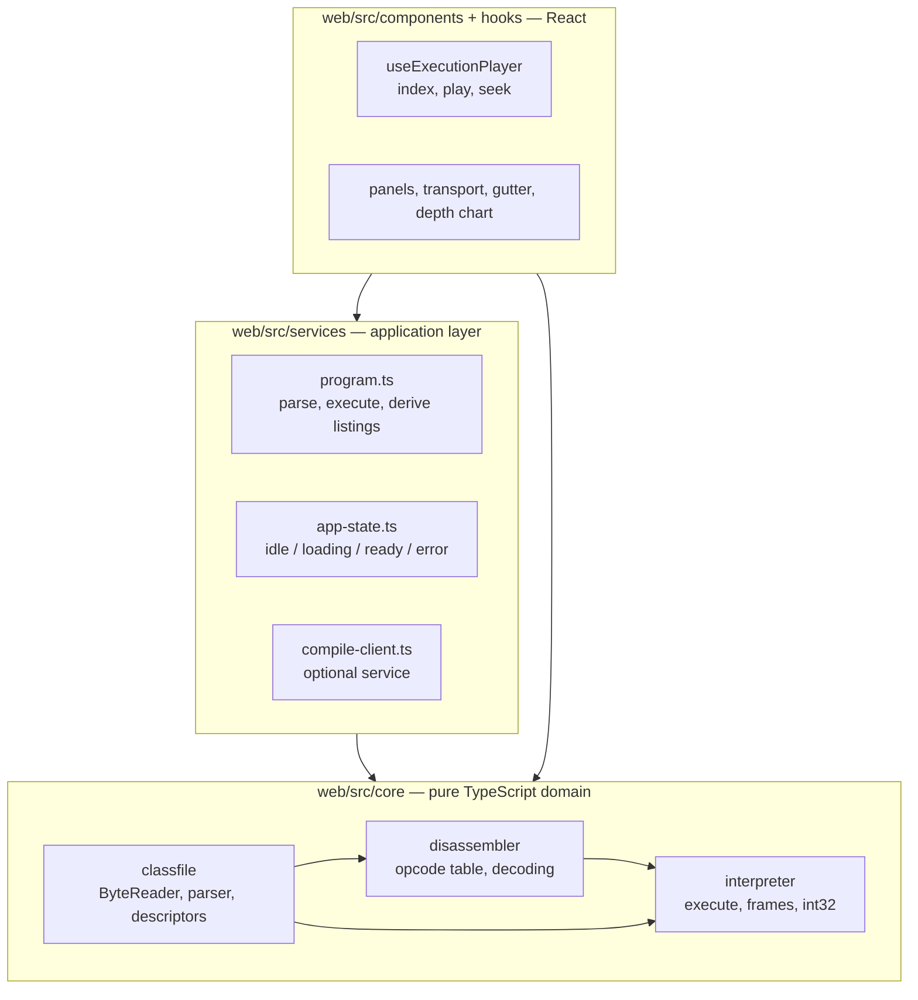
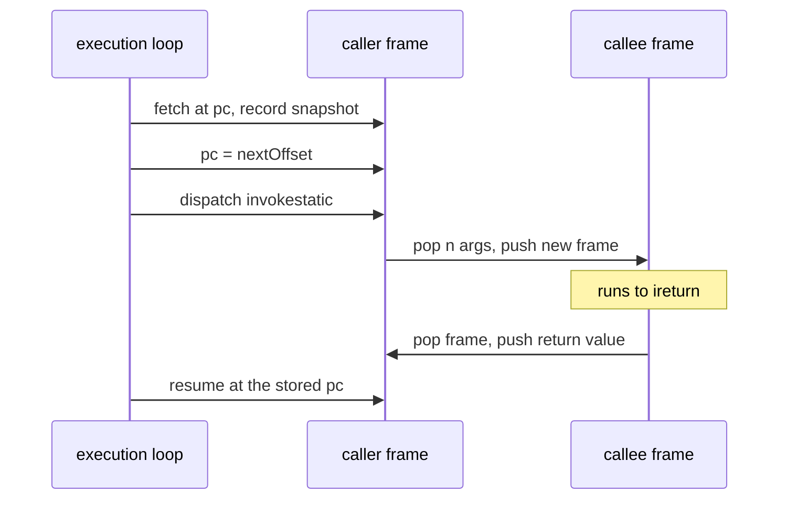

# Architecture

This document is the deeper cut behind the README: how the modules are arranged, why execution is
recorded rather than driven, how a `.class` file becomes a playable history, and what the compile
service does and refuses to do.

The decisions themselves live in [`adr/`](adr/); this document explains how they show up in the
code.

## Module map and the dependency rule



Arrows only ever point down. `core/` is plain TypeScript: no React, no DOM, no imports from
`components/`, `hooks/` or `services/`. That is enforced in `web/eslint.config.js` by a
`no-restricted-imports` block plus `no-restricted-globals` for `window`, `document` and
`localStorage`, so the rule fails a build rather than a review.

The split has a practical payoff beyond tidiness. `web/vite.config.ts` defines two Vitest projects:
`core` runs in a Node environment with no DOM available at all, `ui` runs in jsdom. If a domain
module ever reached for a browser API, its own test suite would be the first thing to notice.

## Why the history is recorded, not driven

The obvious design for a step debugger is an interpreter the UI calls once per step. This project
does the opposite: `execute(classFile, options)` runs the entire program synchronously and returns
an `ExecutionResult` holding an array of frozen `Snapshot` values — one per executed instruction,
capturing the state _before_ that instruction runs, closed by a terminal snapshot with an empty call
stack.

`useExecutionPlayer` then owns nothing but an index. `stepForward`, `stepBack` and `seekTo` are
index arithmetic; the panels read `snapshots[index]`.

**What this buys**

- Stepping backwards needs no inverse of any instruction. A step-driven interpreter would need
  either an undo log — effectively a second implementation of every opcode — or a restart that
  fast-forwards from the beginning, which is slow and easy to make non-deterministic.
- Scrubbing to step N is not a special case. Neither is the depth chart under the scrubber, which is
  just `snapshots.map(s => s.callStack.length)` bucketed for display.
- The interpreter is a pure function of a `ClassFile`. That is what makes differential testing
  against a real JVM and property-based testing of the arithmetic straightforward: input in,
  expected history out, no fixtures for machine state.
- A failed run still produces history. A division by zero or an unsupported opcode returns the
  snapshots collected so far alongside the error, so the UI can show _where_ the program stopped
  instead of only saying that it did.

**What it costs**

- Memory. Every snapshot deep-copies the live frame stack, so cost grows with steps × depth. With
  `int` slots and no heap a frame is small, and the 20,000-step default keeps the worst case
  bounded; the bundled examples produce histories in the tens to low thousands of snapshots. This
  is a consciously accepted cost — see [ADR-0001](adr/0001-snapshot-history.md), which defers
  structural sharing to a version that also brings a benchmark.
- Latency is front-loaded: nothing renders until the run finishes. At MVP scale that is
  milliseconds, but a program that would run for minutes cannot be visualized at all — it hits the
  step limit instead.
- Non-terminating programs have no representation. They become `kind: 'step-limit'`, and the UI has
  to say so plainly rather than pretending the run ended.

## From bytes to a playable history

`buildProgram()` in `web/src/services/program.ts` is the seam where the three domain modules meet.
The path is the same whichever way the bytes arrived — a bundled example, a drag-and-dropped file,
or a response from the compile service:

1. **Parse.** `parseClassFile(buffer)` walks the file with a `ByteReader` cursor over a `DataView`:
   magic, versions, the full constant pool, access flags, fields, methods, and the `Code` attribute
   with its `LineNumberTable` and `LocalVariableTable`. The constant pool is 1-indexed, `Long` and
   `Double` entries occupy two slots with the second left `null`, unknown tags are read and skipped
   by their known lengths, and unknown attributes are skipped by `attribute_length`. The parser is
   deliberately wider than the interpreter, because a modern `javac` emits `StackMapTable`,
   `NestMembers` and friends on every class.
2. **Disassemble.** `disassemble(code)` produces `Instruction[]` — offset, opcode, mnemonic, decoded
   operands and, for branches, an absolute `branchTarget` resolved from the signed delta relative to
   the _opcode's_ offset. Opcodes outside the executable subset still decode with their real
   mnemonic and are flagged `unsupported`, so an error message can say `invokevirtual` rather than
   `0xb6`. Variable-length instructions (`wide`, `tableswitch`, `lookupswitch`) cannot be skipped
   safely without implementing their padding rules, so decoding stops there and the rest of the
   method is reported through `truncatedAtOffset` and rendered as a "not decoded" row.
3. **Execute.** `execute(classFile)` starts from a static entry method — `main([Ljava/lang/String;)V`
   by default — and runs the fetch-decode-execute loop, pushing a snapshot before each instruction.
   Each method is disassembled once per run and cached in a `PreparedMethod`, since loops and
   recursion revisit the same code constantly.
4. **Derive.** `program.ts` also computes what the panels need but the domain has no business
   knowing: per-method listings, the set of offsets the run actually reached (everything else is
   dead code _for this run_), and the source lines to highlight.

The interpreter never throws for anything it anticipates. Internally it uses a `VmFault` to unwind
out of a deeply nested helper, catches it in the main loop, and converts it into a typed
`ExecutionResult`. An exception escaping `execute()` would be a bug in the interpreter, not a
program error.

## Frame lifecycle

A frame (`web/src/core/interpreter/frame.ts`) is mutable during execution — `pc`, an operand stack
and local slots — while snapshots take immutable copies. The subtle part is the program counter, and
it is the reason every frame carries its own.



Two details make this work:

- **The pc advances before dispatch.** By the time `invokestatic` pushes the callee, the caller
  already points at its continuation. Without that ordering, returning would re-execute the call.
- **Arguments land first-argument-first.** They were pushed left to right, so they come off the
  operand stack in reverse and are written into slots `0..n-1` of the new frame (JVMS §2.6.1).

`invokestatic` resolves the `Methodref` through the constant pool and rejects anything the MVP
cannot honor: a different class, a non-static target, a missing `Code` attribute, or a descriptor
with parameters other than `int`. `ireturn` pops the frame and pushes the value onto the caller's
operand stack; when there is no caller left, the value becomes the run's return value. `return` does
the same without a value.

## Error taxonomy

Three distinct failure kinds, deliberately not collapsed into one:

| Kind             | Where              | Shape                                                                                                                  | What it means                                                                                                                     |
| ---------------- | ------------------ | ---------------------------------------------------------------------------------------------------------------------- | --------------------------------------------------------------------------------------------------------------------------------- |
| `ClassFileError` | `core/classfile`   | `bad-magic`, `truncated`, `unknown-constant-tag`, `bad-index`, `malformed-utf8`, `malformed-structure`, bad descriptor | These bytes are not a class file this parser can read. Thrown, always with a byte offset and context.                             |
| `VmError`        | `core/interpreter` | `unsupported-opcode`, `division-by-zero`, `unsupported-call`, `invalid-state`                                          | The file parsed, but the run cannot continue. Returned, never thrown, together with the history so far.                           |
| `step-limit`     | `core/interpreter` | `{ kind: 'step-limit', limit }`                                                                                        | Not an error at all — the run was cut short. The history is complete and playable up to the limit, and the UI offers to raise it. |

`web/src/services/errors.ts` widens those into one `AppError` union that also covers failures which
only exist at the application boundary — an example that would not download, a file over the 512 KiB
upload cap, a file that could not be read — and maps every variant to its banner wording and
severity in one place. A stopped run is an error; a run that merely ran out of steps is a warning.

The rule this taxonomy exists to serve: a failure that still has history keeps the program loaded.
`app-state.ts` models that explicitly — the `error` state carries an optional `LoadedProgram`, so
the grid and the transport stay alive over whatever was recorded before the failure.


## The compile service

An optional Spring Boot 3 / Java 21 service whose only job is turning source into bytes.

```
POST /api/compile  { "source": "public class Foo { … }" }

200 → { "success": true,  "className": "Foo", "classFileBase64": "yv66vg…", "diagnostics": [] }
200 → { "success": false, "className": null,  "classFileBase64": null,
        "diagnostics": [{ "line": 3, "column": 12, "kind": "ERROR", "message": "';' expected" }] }
400 → empty source, source over the size cap, or no public top-level class
429 → rate limited
```

The pipeline is `CompileController` → `CompileService` → `SourceValidator` → `InMemoryCompiler`.
Nothing touches the filesystem: an `InMemoryFileManager` extends `ForwardingJavaFileManager` and
hands javac an `InMemoryClassFile` for every output it asks to write, collecting the bytes in a map.
Reads still go through the delegate, because `--release 21` needs the platform classes.

A compilation that succeeds must produce exactly one class file. More than one means nested, local
or anonymous classes, which the visualizer cannot load — that is reported as a diagnostic rather
than silently returning the first one.

**Hardening** — the point of [ADR-0003](adr/0003-backend-compiles-never-executes.md) is that the
service compiles and never executes, so the sandboxing problem is removed rather than mitigated.
What remains is javac's own resource appetite:

- `-proc:none`. Annotation processing is the one path that runs foreign code inside javac. A test
  puts a processor on the processor path and asserts it never ran.
- An empty user class path. Left unset, javac falls back to the working directory.
- `--release 21`, which also pins the class file version the browser interpreter expects, and `-g`,
  which gives the UI its local variable names.
- No class loader. `getClassLoader()` returns `null`, keeping the guarantee local to the file
  manager instead of relying on the compiler flags alone.
- Source capped at 64 KiB and rejected before javac is invoked.
- A 10 s timeout: the task runs on a daemon thread and is collected with `Future.get(timeout)`, then
  cancelled.
- A per-IP fixed-window rate limit, 10 requests per minute, applied by a filter scoped to `/api/*`
  so health checks are never throttled. `X-Forwarded-For` is trusted only when explicitly enabled,
  because a client can otherwise forge it.
- CORS restricted to the configured frontend origin, `POST`/`OPTIONS` only.
- Actuator exposes `health` and nothing else, with `show-details: never`.

On the client side, `compile-client.ts` validates every response with zod before it becomes a domain
value and returns typed results instead of throwing. The editor renders only when
`VITE_COMPILE_API_URL` is set at build time _and_ the health check answers, so a sleeping free-tier
backend degrades to an application that simply does not have that tab
([ADR-0004](adr/0004-backend-as-progressive-enhancement.md)).

## Testing strategy

Four layers, each answering a different question.

**Differential — "does this agree with a real JVM?"** `build-fixtures.mjs` compiles each example
with `javac -g --release 21` and then runs it on a real JVM through a small harness, recording the
result in `manifest.json` as `expectedResult`. `differential.test.ts` executes the same committed
class files in this interpreter and compares. The fixtures are committed, so CI needs no JDK, and
the expected numbers come from the JVM rather than from this codebase.

**Property-based — "is this right for inputs nobody thought to write down?"** fast-check drives two
areas. `int32.test.ts` compares every arithmetic operation against exact `BigInt` arithmetic
truncated to the low 32 bits, which is the definition of `int` in JVMS §2.3.1 — a missing `| 0` or a
`*` where `Math.imul` belongs fails immediately, as do the `INT_MIN / -1` and `INT_MIN % -1` corner
cases. `parser.test.ts` throws random buffers, random tails appended to a valid class file, and
arbitrary truncations of one at the parser, asserting it always fails with a typed `ClassFileError`
and never with a raw `RangeError` from `DataView`.

**Parity — "does this match the reference tooling?"** Parser expectations are transcribed from
`javap -v -p Factorial.class` and disassembler expectations from `javap -c`, including resolved
branch targets. The full dump is committed at
`web/src/core/classfile/__fixtures__/Factorial.javap.txt` so a reviewer can check the numbers
without running anything.

**End to end — "does the product work?"** Playwright drives the production bundle, not the dev
server: `playwright.config.ts` builds and serves `dist/` on port 4173 itself. The specs replay a
recursive program from the welcome screen to its result, scrub into the recursion and assert the
call stack, check the keyboard transport, verify that every code row keeps the 26px rhythm the
design depends on, and confirm that a rejected file leaves the application usable. The spec covering
the compile service skips itself unless `PLAYWRIGHT_COMPILE_API_URL` is set, which keeps the default
run green without a backend.

Underneath all of it: around 450 unit and component tests, and a coverage threshold of 90% lines,
branches and functions on `web/src/core/**` that CI enforces.
