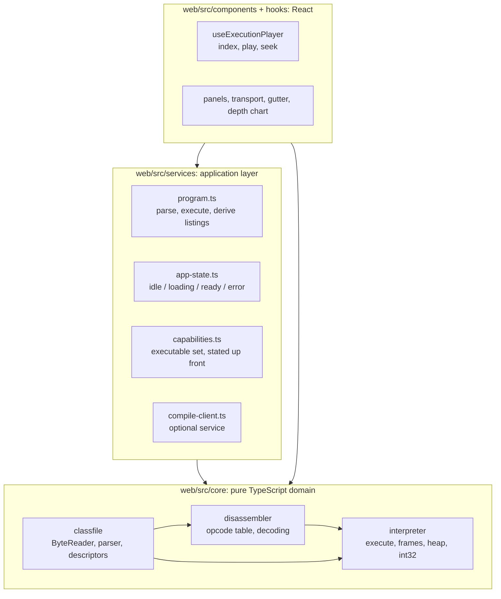
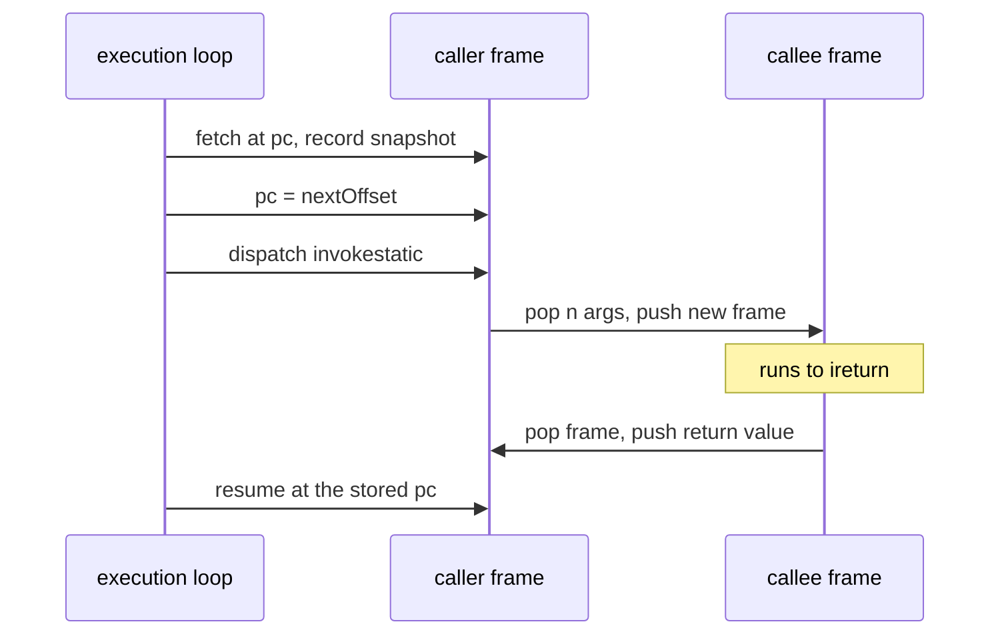
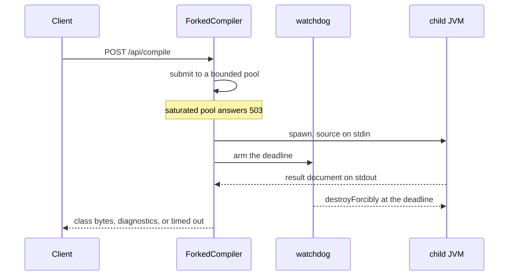

# Architecture

This document goes deeper than the README: how the modules are arranged, why execution is recorded
and not driven, how a `.class` file becomes a playable history, and what the compile service
does and refuses to do.

The decisions themselves live in [`adr/`](adr/); this document explains how they show up in the
code.

## Module map and the dependency rule



Arrows only ever point down. `core/` is plain TypeScript: no React, no DOM, no imports from
`components/`, `hooks/` or `services/`. That is enforced in `web/eslint.config.js` by a
`no-restricted-imports` block plus `no-restricted-globals` for `window`, `document` and
`localStorage`, so a build fails on it and not a review.

The split has a practical payoff beyond tidiness. `web/vite.config.ts` defines two Vitest projects:
`core` runs in a Node environment with no DOM available at all, `ui` runs in jsdom. If a domain
module ever reached for a browser API, its own test suite would be the first thing to notice.

## Execution is recorded, not driven

The obvious design for a step debugger is an interpreter the UI calls once per step. This project
does the opposite: `execute(classFile, options)` runs the entire program synchronously and returns
an `ExecutionResult` holding an array of frozen `Snapshot` values, one per executed instruction,
capturing the state _before_ that instruction runs, closed by a terminal snapshot with an empty call
stack.

`useExecutionPlayer` then owns nothing but an index. `stepForward`, `stepBack` and `seekTo` are
index arithmetic; the panels read `snapshots[index]`.

### Benefits

- Stepping backwards needs no inverse of any instruction. A step-driven interpreter would need
  either an undo log, effectively a second implementation of every opcode, or a restart that
  fast-forwards from the beginning, which is slow and easy to make non-deterministic.
- Scrubbing to step N is not a special case. Neither is the depth chart under the scrubber, which is
  just `snapshots.map(s => s.callStack.length)` bucketed for display.
- The interpreter is a pure function of a `ClassFile`. That is what makes differential testing
  against a real JVM and property-based testing of the arithmetic straightforward: input in,
  expected history out, no fixtures for machine state.
- A failed run still produces history. A division by zero or an unsupported opcode returns the
  snapshots collected so far alongside the error, so the UI can show _where_ the program stopped
  instead of only saying that it did.

### Costs

- Memory. Machine state has to be copied out of the mutable interpreter, and the naive form of that,
  a deep copy of the whole call stack and the whole heap per step, costs steps × (depth + arrays).
  What makes it affordable is that a snapshot is immutable, so the parts that did not change do not
  need a second copy. `SnapshotWriter` keeps the frozen frame it last emitted at each depth together
  with the version of the `Frame` it came from, and between two consecutive instructions only the
  top of the stack moves; the heap does the same per array, keyed on a per-array version behind a
  heap-wide revision, and hands back the identical view when a step touched no array at all. Every
  frame and every array is therefore copied once per change instead of once per step, a slot holds
  one 32-bit number, and the 20,000-step default bounds the worst case; the bundled examples produce
  histories in the tens to low thousands of snapshots. The remaining cost is accepted, see
  [ADR-0001](adr/0001-snapshot-history.md); persistent data structures, and the benchmark that would
  justify them, stay deferred.
- Latency is front-loaded: nothing renders until the run finishes. At MVP scale that is
  milliseconds, but a program that would run for minutes cannot be visualized at all, and hits the
  step limit instead.
- Non-terminating programs have no representation. They become `kind: 'step-limit'`, and the UI says
  so, instead of pretending the run ended.

## From bytes to a playable history

`buildProgram()` in `web/src/services/program.ts` is the seam where the three domain modules meet.
The path is the same whichever way the bytes arrived: a bundled example, a drag-and-dropped file, or
a response from the compile service.

1. Parse. `parseClassFile(buffer)` walks the file with a `ByteReader` cursor over a `DataView`:
   magic, versions, the full constant pool, access flags, fields, methods, and the `Code` attribute
   with its `LineNumberTable` and `LocalVariableTable`. The constant pool is 1-indexed, `Long` and
   `Double` entries occupy two slots with the second left `null`, unknown tags are read and skipped
   by their known lengths, and unknown attributes are skipped by `attribute_length`. The parser is
   wider than the interpreter, because a modern `javac` emits `StackMapTable`, `NestMembers` and
   friends on every class.
2. Disassemble. `disassemble(code)` produces `Instruction[]`: offset, opcode, mnemonic, decoded
   operands and, for branches, an absolute `branchTarget` resolved from the signed delta relative to
   the _opcode's_ offset. Decoding is wider than execution: every assigned opcode below `0xca`
   carries its real operand specification, so an opcode outside the executable subset still decodes
   with its mnemonic, its operands and its constant pool references, and is flagged `unsupported`
   only to say that running it would stop the program. That is what lets a class this machine will
   never execute still read like `javap -c`. The two switches arrive with their jump tables in
   `Instruction.switchTargets`, and `wide` is folded into the instruction it widens instead of
   listed separately, which is the representation javap prints. `truncatedAtOffset` is left for
   bytes that genuinely have no instruction boundary after them (a reserved or unassigned opcode, an
   operand cut off by the end of `code[]`, a switch table that does not fit), and is rendered as a
   "not decoded" row.
3. Execute. `execute(classFile)` starts from a static entry method, `main([Ljava/lang/String;)V` by
   default, and runs the fetch-decode-execute loop, pushing a snapshot before each instruction. Each
   method is disassembled once per run and cached in a `PreparedMethod`, since loops and recursion
   revisit the same code constantly.
4. Derive. `program.ts` also computes what the panels need but the domain does not know about:
   per-method listings, the set of offsets the run actually reached (everything else is dead code
   _for this run_), and the source lines to highlight.

The interpreter never throws for anything it anticipates. Internally it uses a `VmFault` to unwind
out of a deeply nested helper, catches it in the main loop, and converts it into a typed
`ExecutionResult`. An exception escaping `execute()` would be a bug in the interpreter, not a
program error.

## Frame lifecycle

A frame (`web/src/core/interpreter/frame.ts`) is mutable during execution, holding `pc`, an operand
stack and local slots, while snapshots take immutable copies. The subtle part is the program
counter, and it is the reason every frame carries its own.



Two details make this work:

- The pc advances before dispatch. By the time `invokestatic` pushes the callee, the caller already
  points at its continuation. Without that ordering, returning would re-execute the call.
- Arguments land first-argument-first. They were pushed left to right, so they come off the operand
  stack in reverse and are written into slots `0..n-1` of the new frame (JVMS §2.6.1).

`invokestatic` resolves the `Methodref` through the constant pool and rejects anything the MVP
cannot honor: a different class, a non-static target, a missing `Code` attribute, or a descriptor
with parameters other than `int`. `ireturn` pops the frame and pushes the value onto the caller's
operand stack; when there is no caller left, the value becomes the run's return value. `return` does
the same without a value.

## The heap

Locals and the operand stack hold everything an `int`-only program has. An array does not fit that
shape: it outlives the instruction that built it, and the slot that refers to it names it rather
than holds it. `web/src/core/interpreter/heap.ts` is where those objects live (JVMS §2.5.3): one
heap per run, shared by every frame, never unwound when a frame returns.

It holds fixed-length arrays of `int` and no other object: `newarray` allocates for `atype = T_INT`
and rejects any other element type before it pops the count, and `iaload`, `iastore` and
`arraylength` work on what it allocated. Where that boundary sits and why it moved there is
[ADR-0005](adr/0005-heap-of-int-arrays.md); the definitive list of what the machine executes is the
dispatch `switch` in `web/src/core/interpreter/interpreter.ts`.

Three properties shape everything above it:

- A reference is a handle. The value a `ref` slot holds is the array's index in the heap, so
  `snapshot.heap[h]` is the object and no pointer arithmetic is expressible. `null` is the handle
  `-1`, at which no array ever lives (JVMS §2.4); any handle that names no cell, including one that
  was never allocated, stops the run with the `NullPointerException` a real JVM would raise. The UI
  can therefore render a reference as what it points at, `int[5]@0`, and not as a bare number
  that means nothing on its own.
- It is append-only. Nothing is freed and handles are never reused, so there is no collector and no
  question about what a handle in an old snapshot refers to. That is what makes the frozen view
  cheap: `freeze()` re-copies only the arrays whose per-array version moved and hands back the
  identical view for a step that touched none, which is the sharing the memory argument above
  depends on.
- Every value carries its kind. A `ValueKind` of `int` or `ref` travels with each operand stack cell
  and each local slot, pushed and popped with the value. Both are plain numbers, so nothing but that
  tag distinguishes the integer 3 from the reference to the array at handle 3, and the interpreter
  refuses to read one as the other: `iload` on a slot holding a reference, or `arraylength` on an
  `int`, stops the run instead of computing something plausible. In a real JVM this never comes up
  at run time, because the verifier proves it statically before the method executes (JVMS §4.10).
  This interpreter has no verifier, so it does the equivalent check where it can, at the instruction
  that would have been wrong.

Snapshots grew for this additively: `heap`, `operandKinds` and `localKinds` are optional fields that
`execute()` always fills, so a consumer that only reads numbers is unaffected and an `int`-only run
carries the same frozen empty heap on every step.

## Error taxonomy

Three distinct failure kinds, kept apart instead of collapsed into one:

| Kind             | Where              | Shape                                                                                                                                                                                                                | What it means                                                                                                             |
| ---------------- | ------------------ | -------------------------------------------------------------------------------------------------------------------------------------------------------------------------------------------------------------------- | ------------------------------------------------------------------------------------------------------------------------- |
| `ClassFileError` | `core/classfile`   | `bad-magic`, `truncated`, `unknown-constant-tag`, `bad-index`, `malformed-utf8`, `malformed-structure`, bad descriptor                                                                                               | These bytes are not a class file this parser can read. Thrown, always with a byte offset and context.                     |
| `VmError`        | `core/interpreter` | `unsupported-opcode`, `division-by-zero`, `unsupported-call`, `invalid-state`, `stack-overflow`, `bad-branch-target`, `array-index-out-of-bounds`, `negative-array-size`, `null-reference`, `unsupported-array-type` | The file parsed, but the run cannot continue. Returned, never thrown, together with the history so far.                   |
| `step-limit`     | `core/interpreter` | `{ kind: 'step-limit', limit }`                                                                                                                                                                                      | Not an error: the run was cut short. The history is complete and playable up to the limit, and the UI offers to raise it. |

Three of the `VmError` kinds exist because the interpreter has no bytecode verifier and refuses to
run off its own rails. `stack-overflow` stops the run at `DEFAULT_MAX_CALL_DEPTH` (1,500 frames) and
borrows the wording of a real `StackOverflowError`, so recursion without a reachable base case is
named for what it is instead of being reported as a step limit, and it stops long before the history
exhausts the browser tab. `bad-branch-target` rejects a jump that does not land on the first byte of
an instruction of the same method (JVMS §4.9.1); it is checked once when a method is prepared, so a
target inside another instruction's operands is named at the branch instead of surfacing later as
whatever byte the pc happened to hit. `invalid-state` covers the rest: an empty operand stack at
`iadd`, a read from an uninitialised slot, or a reference used where an `int` belongs, which is the
kind check described under the heap, the verifier's work done at the instruction instead of ahead
of the method (JVMS §4.10).

The kinds that correspond to a runtime exception are worded as that exception:
`ArithmeticException: / by zero` for `division-by-zero`, and `ArrayIndexOutOfBoundsException`,
`NegativeArraySizeException` and `NullPointerException` for the three array kinds. The machine has
no `athrow` and no `exception_table`, so these end the run instead of being catchable, but a reader
who meets one here should recognise it the next time a real stack trace shows it.

`web/src/services/errors.ts` widens those into one `AppError` union that also covers failures which
only exist at the application boundary (an example that would not download, a file over the 512 KiB
upload cap, a file that could not be read) and maps every variant to its banner wording and severity
in one place. A stopped run is an error; a run that merely ran out of steps is a warning.

The rule this taxonomy exists to serve: a failure that still has history keeps the program loaded.
`app-state.ts` models that explicitly. The `error` state carries an optional `LoadedProgram`, so the
grid and the transport stay alive over whatever was recorded before the failure.


The other half of not surprising anyone is saying what the machine can run _before_ a file is
loaded, and that statement is derived, not written down. `web/src/services/capabilities.ts`
intersects the disassembler's opcode table with the interpreter's `EXECUTABLE_OPCODES`: the
instruction families on the welcome screen are the executable opcodes grouped by the blocks the JVMS
§6.5 tables lay them out in, and the missing Java features are the entries whose required
instructions are not all executable yet. An opcode that gains an implementation therefore joins its
family and drops off the gap list with no file to edit, and the welcome screen cannot claim
something the dispatch `switch` does not do. Only the naming is editorial, plus one note that no
opcode can express: that `invokestatic` resolves against the uploaded class alone, which is the one
sentence there someone has to keep true by hand.

## The compile service

An optional Spring Boot 3 / Java 21 service whose only job is turning source into bytes.

```
POST /api/compile  { "source": "public class Foo { … }" }

200 → { "success": true,  "className": "Foo", "classFileBase64": "yv66vg…", "diagnostics": [] }
200 → { "success": false, "className": null,  "classFileBase64": null,
        "diagnostics": [{ "line": 3, "column": 12, "kind": "ERROR", "message": "';' expected" }] }
400 → empty source, a body or a source over the size cap, or no public top-level class
429 → rate limited
503 → every compile slot is taken; carries Retry-After
```

The pipeline is `CompileController` → `CompileService` → `SourceValidator` → `ForkedCompiler`, and
the compilation itself happens one process further out.

### One child JVM per compilation

`InMemoryCompiler`, the class that actually calls javac, has no timeout of its own, because a
runaway javac cannot be stopped from inside the JVM that hosts it. `Future.cancel(true)` raises an
interrupt flag javac never polls, so a source with pathological type inference kept a thread at 100%
CPU long after the client had its answer, one thread per request. `destroyForcibly()` on a child
process is the construction that actually reclaims a running compiler, so that is the one the
service uses.



- The parent bounds concurrency. A `ThreadPoolExecutor` over a `SynchronousQueue` with an abort
  policy holds `compile.max-concurrent-compilations` slots, two by default. Nothing queues: a
  compilation costs a whole JVM, and a queue of requests each holding one is worse for everyone than
  telling the caller to come back, so a saturated pool answers 503 with `Retry-After`.
- The child is small and short-lived. `java -Xmx128m -Xss1m … CompilerProcessMain`, plus the serial
  collector, `-XX:TieredStopAtLevel=1` because start-up dominates the wall clock here, and no perf
  data file, reads the source from stdin, runs the same `InMemoryCompiler`, writes a JSON result
  document to stdout and halts. It takes the real stdout for itself and points `System.out` at
  stderr, so a stray `println` cannot corrupt the protocol, and a `StackOverflowError` or an
  `OutOfMemoryError` lands in a process that exists to absorb it.
- The deadline is a kill, not a request. A watchdog scheduled at `compile.timeout` (10 s) calls
  `destroyForcibly()`, which closes both pipes, so no read can outlast it. The request thread waits
  that budget plus a five second reaping grace, and the `finally` block destroys the process again,
  so no orphan survives the method whatever went wrong.
- The child runs on the parent's `java.class.path`, so the deployment has to expose one a plain
  `java -cp` understands. The Dockerfile runs the application exploded for exactly that reason, and
  `ForkedCompiler` logs an error at start-up if it finds itself inside a repackaged jar, instead of
  failing one request at a time in production.

Nothing touches the filesystem on the way through: an `InMemoryFileManager` extends
`ForwardingJavaFileManager` and hands javac an `InMemoryClassFile` for every output it asks to
write, collecting the bytes in a map. Reads still go through the delegate, because `--release 21`
needs the platform classes.

A compilation that succeeds must produce exactly one class file. More than one means nested, local
or anonymous classes, which the visualizer cannot load; that comes back as a diagnostic and not
silently returning the first one.

### Hardening

The point of [ADR-0003](adr/0003-backend-compiles-never-executes.md) is that the service compiles
and never executes, so the sandboxing problem is removed instead of mitigated. What remains is
javac's own resource appetite and the ordinary exposure of a public endpoint.

- A child process per compilation, bounded in number and killed at the deadline, as described above.
- `-proc:none`. Annotation processing is the one path that runs foreign code inside javac. A test
  puts a processor on the processor path and asserts it never ran.
- An empty user class path. Left unset, javac falls back to the working directory; emptied, the only
  types a source can reach are the platform classes.
- `--release 21`, which also pins the class file version the browser interpreter expects, and `-g`,
  which gives the UI its local variable names.
- No class loader. `getClassLoader()` returns `null`, keeping the guarantee local to the file
  manager instead of relying on the compiler flags alone.
- No output other than class files. `getFileForOutput` throws, so `-s`, `-h` and any `Filer`
  resource fail loudly instead of quietly writing a file relative to the working directory.
- Size caps that hold before anything is buffered. `RequestSizeLimitFilter` refuses a body over
  `compile.max-request-size` (256 KiB) on `Content-Length`, and wraps the stream in a counting one
  for a chunked request that declares no length; Jackson's maximum string length is lowered to 70
  KiB for the body that stays small but declares one enormous field; `SourceValidator` then rejects
  a source over 64 KiB before javac is invoked. The check used to live only in the service, on the
  already-parsed string, which put an out-of-memory exit one request away.
- A per-IP fixed window rate limit, 10 requests per minute, held in a Caffeine cache bounded to
  10,000 clients and expiring with the window. A plain map grew with every address seen, which one
  attacker with a large range turns into unbounded memory and an O(n) sweep per request. The key is
  the address counted from the _right_ of `X-Forwarded-For`, `compile.rate-limit.trusted-proxy-hops`
  entries in, and only when the header is explicitly trusted and the entry parses as an IP literal;
  everything to the left of the trusted hop is written by the caller. Preflights are not counted,
  and the filter is scoped to `/api/*` so health checks are never throttled.
- CORS ahead of the limiter. The CORS filter runs at the highest precedence, before the rate limit
  and the size cap, so a 429 or a 400 still carries `Access-Control-Allow-Origin` and the page can
  read the error it caused; MVC's own CORS handling runs far too late for that. It allows the
  configured origin only, `POST`/`OPTIONS` and `Content-Type`, and an `allowed-origin` of `*` is
  rejected at start-up.
- One error shape. Every failure leaves as `{ error, message }`. `ApiExceptionHandler` extends
  `ResponseEntityExceptionHandler`, which is what brings the paths nobody thinks about (404,
  405, 415) under that contract; without it Spring answers those with a `ProblemDetail` body the
  client's zod schema rejects, and a wrong `Content-Type` reads as "the service is broken".
- No regex over untrusted source. `SourceNames` finds the public top-level type in a single linear
  scan that skips comments and literals. The regular expression it replaced recursed once per
  repetition of a modifier list, so `"public " + "final ".repeat(3000)` raised a
  `StackOverflowError`, which no `@RestControllerAdvice` can catch.
- Actuator exposes `health` and nothing else, with `show-details: never`.

On the client side, `compile-client.ts` validates every response with zod before it becomes a domain
value and returns typed results instead of throwing. The editor renders only when
`VITE_COMPILE_API_URL` is set at build time _and_ the health check answers, so a sleeping free-tier
backend degrades to an application that simply does not have that tab
([ADR-0004](adr/0004-backend-as-progressive-enhancement.md)).

## Testing strategy

Four layers, each answering a different question.

### Differential: does this agree with a real JVM?

`build-fixtures.mjs` compiles each example with `javac -g --release 21` and then runs it on a real
JVM through a small harness, recording the result in `manifest.json` as `expectedResult`.
`differential.test.ts` executes the same committed class files in this interpreter and compares. The
fixtures are committed, so CI needs no JDK, and the expected numbers come from the JVM and not
from this codebase.

### Property-based: is this right for inputs nobody wrote down?

fast-check drives two areas. `int32.test.ts` compares every arithmetic operation against exact
`BigInt` arithmetic truncated to the low 32 bits, which is the definition of `int` in JVMS §2.3.1. A
missing `| 0` or a `*` where `Math.imul` belongs fails immediately, as do the `INT_MIN / -1` and
`INT_MIN % -1` corner cases. `parser.test.ts` throws random buffers, random tails appended to a
valid class file, and arbitrary truncations of one at the parser, asserting it always fails with a
typed `ClassFileError` and never with a raw `RangeError` from `DataView`.

### Parity: does this match the reference tooling?

Parser expectations are transcribed from `javap -v -p Factorial.class` and disassembler expectations
from `javap -c`, including resolved branch targets. The full dump is committed at
`web/src/core/classfile/__fixtures__/Factorial.javap.txt` so a reviewer can check the numbers
without running anything.

### End to end: does the product work?

Playwright drives the production bundle, not the dev server: `playwright.config.ts` builds
and serves `dist/` on port 4173 itself. The specs replay a recursive program from the welcome screen
to its result, scrub into the recursion and assert the call stack, check the keyboard transport,
verify that every code row keeps the 26px rhythm the design depends on, and confirm that a rejected
file leaves the application usable. The spec covering the compile service skips itself unless
`PLAYWRIGHT_COMPILE_API_URL` is set, which keeps the default run green without a backend.

Underneath all of it: around 450 unit and component tests, and a coverage threshold of 90% lines,
branches and functions on `web/src/core/**` that CI enforces.
