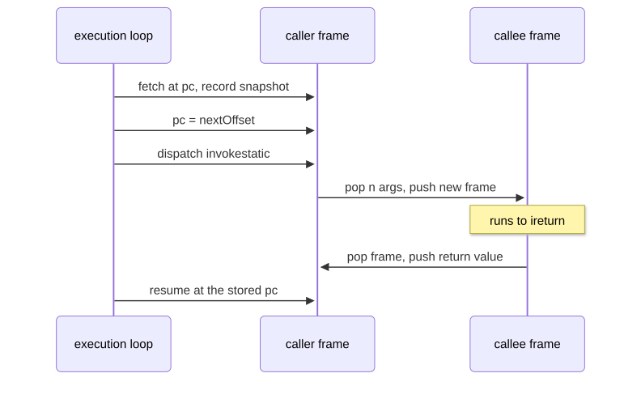
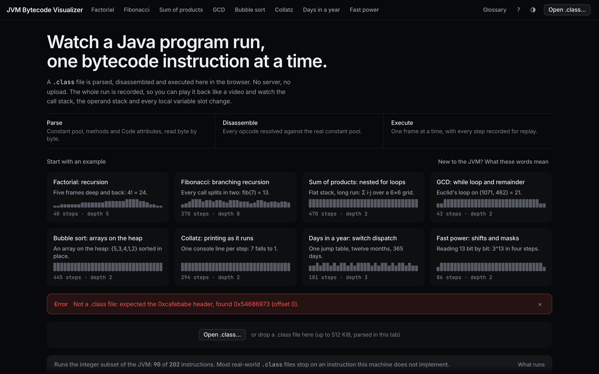
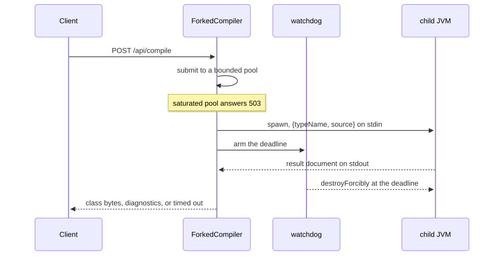

# Architecture

## Module map and the dependency rule

<picture>
  <source media="(prefers-color-scheme: dark)" srcset="diagrams/module-map-dark.svg">
  
</picture>

Arrows only ever point down. `core/` is plain TypeScript: no React, no DOM, no imports from
`components/`, `hooks/` or `services/`. `web/eslint.config.js` enforces that with
`no-restricted-imports`, which also covers `services/**` and `workers/**`; neither may import from
`components/` or `hooks/`. `no-restricted-globals` for `window`, `document` and `localStorage`
covers `core/**` and `workers/**`. Under jsdom a DOM reference in either typechecks and passes its
tests, then throws in the real worker. The rule stops short of `services/**`, where deep links, the
theme, telemetry and embed detection legitimately read the browser.

Everything outside `core/` reaches it through the three module barrels. A deep import of a module a
barrel already re-exports is refused in `services/**`, `components/**`, `hooks/**`, `workers/**`,
`App.tsx` and `main.tsx`, and `web/scripts/check-imports.mjs` fails the web workflow on an import
cycle. `web/vite.config.ts` runs `core` as a Vitest project of its own, in a Node environment with
no DOM available at all.

## Execution is recorded ahead of time

A step debugger is usually an interpreter the UI calls once per step. Here the whole run happens
first. `execute(classFile, options)` runs the entire program synchronously and returns an
`ExecutionResult` holding an array of frozen `Snapshot` values, one per executed instruction, each
capturing the state _before_ that instruction runs. A terminal snapshot with an empty call stack
closes the history. `useExecutionPlayer` drives the run from an index; `stepForward`, `stepBack` and
`seekTo` are index arithmetic, and the panels read `snapshots[index]`.

Stepping backwards needs no inverse of any instruction. The alternative is an undo log, a second
implementation of every opcode, or a restart that fast-forwards from the beginning. Scrubbing to
step N is not a special case. A failed run still produces history: a division by zero or an
unsupported opcode returns the snapshots collected so far alongside the error, and the UI shows
_where_ the program stopped. The definitive list of what the machine executes is the `Op` table in
`web/src/core/interpreter/interpreter.ts`, from which `EXECUTABLE_OPCODES` is built.

The cost is memory. A deep copy of the whole call stack and the whole heap per step would cost
steps × (depth + arrays). A snapshot is immutable, so the parts that did not change need no second
copy. `SnapshotWriter` keeps the frozen frame it last emitted at each depth with the version of the
`Frame` it came from, and between two consecutive instructions only the top of the stack moves. The
heap does the same per array, keyed on a per-array version behind a heap-wide revision. Two hundred
nested calls produce 1,408 snapshots holding 1,608 frozen frames, where copying the whole call stack
per step would produce 142,911: 88.9× fewer. `web/src/core/interpreter/performance.test.ts` pins
those three counts exactly and checks that a flat run costs one frame per step.

Latency is front-loaded: nothing renders until the run finishes. A program that would run for
minutes cannot be visualized at all, and hits the step limit instead.

### Where the run happens

`execute()` is one synchronous call that returns when the program has finished, and a pure function.
Only the thread it runs on changed. `web/src/services/loading/program-runner.ts` picks between two
runners with the same interface: `inlineRunner` calls `execute()` on the main thread, `workerRunner`
posts the class file to `web/src/workers/run-program.worker.ts`. `runAndStream(command, post)` in
`run-protocol.ts` calls `execute()`, then hands the history back in `snapshots` messages of
`SNAPSHOTS_PER_MESSAGE` (2,000), followed by a `done` message carrying the outcome with the history
stripped out.

### What a long run costs

A 500,000-step run, measured on V8:

|                                                |          |
| ---------------------------------------------- | -------- |
| `execute()` itself                             | 404 ms   |
| Serializing the history into one `postMessage` | 1,443 ms |
| Deserializing it on the receiving side         | 2,591 ms |
| Heap held by the history in the worker         | 274 MB   |
| Heap held by the same history after transfer   | ~610 MB  |

Deserialization lands on the receiving thread. Posting the history as one message would move a
404 ms block off the main thread and put a 2,591 ms one back on it. Batches of 2,000 split that cost
into tasks the browser can interleave with painting: on the built application in Chromium the
longest main-thread stall falls from 403 ms to about 120 ms, and the run takes roughly three times
as long end to end. The transferred copy is unfrozen and 2.2× the size of the one in the worker.

Those two heap figures are 575 and 1,279 bytes a step, read by `affordableStepLimit()` in
`web/src/services/loading/app-state.ts`. The peak of a re-run holds three histories, the worker's
copy and two transferred ones, so 3,133 bytes a step. The ceiling is an eighth of
`navigator.deviceMemory` divided by that, clamped to the 20,000 default below and 500,000 above.

## Frame lifecycle

A frame (`web/src/core/interpreter/frame.ts`) is mutable during execution, holding `pc`, an operand
stack and local slots; snapshots take immutable copies. The program counter is the subtle part, and
the reason every frame carries its own.

<picture>
  <source media="(prefers-color-scheme: dark)" srcset="diagrams/frame-lifecycle-dark.svg">
  
</picture>

Two details make this work:

- The pc advances before dispatch. By the time `invokestatic` pushes the callee, the caller already
  points at its continuation. Without that ordering, returning would re-execute the call.
- Arguments land first-argument-first. They were pushed left to right, so they come off the operand
  stack in reverse and are written into slots `0..n-1` of the new frame (JVMS §2.6.1).

## The heap

`web/src/core/interpreter/heap.ts` is where arrays and objects live (JVMS §2.5.3): one heap per run,
shared by every frame, never unwound when a frame returns. A reference is a handle. The value a
`ref` slot holds is the cell's index in the heap, so `snapshot.heap[h]` is the object, no pointer
arithmetic is expressible, and the UI can draw a reference as what it points at, `int[5]@0`. `null`
is the handle `-1`, at which nothing ever lives (JVMS §2.4).

Every value carries its kind. A `ValueKind` of `int`, `ref` or `external` travels with each operand stack cell
and each local slot, pushed and popped with the value. Both are plain numbers, so nothing but that
tag distinguishes the integer 3 from the reference to the array at handle 3. The interpreter refuses
to read one as the other: `iload` on a slot holding a reference, or `arraylength` on an `int`, stops
the run. A real JVM never meets this at run time, because the verifier proves it statically before
the method executes (JVMS §4.10). This interpreter has no verifier and does the equivalent check at
the instruction that would have been wrong.

## Error taxonomy

Three distinct failure kinds, kept apart instead of collapsed into one. `ClassFileError`, in
`core/classfile`: these bytes are not a class file this parser can read. Thrown, always with a byte
offset and context. `VmError`, in `core/interpreter`: the file parsed, but the run cannot continue.
Returned, never thrown, together with the history so far. `step-limit`: the run was cut short rather
than failing, and the history is playable up to the limit. `VmError` is built in
`web/src/core/interpreter/types.ts` so every kind carries the `offset` and `methodName` where it
happened, and `web/src/services/loading/errors.ts` widens those into one `AppError` union that also
covers the failures which only exist at the application boundary.

The interpreter never throws for anything it anticipates. Internally it uses a `VmFault` to unwind
out of a deeply nested helper, catches it in the main loop, and converts it into a typed
`ExecutionResult`. An exception escaping `execute()` would be a bug in the interpreter, not a
program error.

A failure that still has history keeps the program loaded. The `error` state in `app-state.ts`
carries an optional `LoadedProgram`, and the grid and the transport stay alive over whatever was
recorded before the failure.

## The compile service

An optional Spring Boot 3 / Java 21 service whose only job is turning source into bytes. The
pipeline is `CompileController` → `CompileService` → `SourceValidator` → `ForkedCompiler`, and the
compilation itself happens one process further out. Its responses are committed as fixtures under
`server/src/test/resources/contract/`, one JSON document per case holding the status, the headers
that matter and the body. The server's tests assert it produces them and the web client's tests
parse them, so the two ends of the contract are checked against the same bytes.

### One child JVM per compilation

`InMemoryCompiler`, the class that actually calls javac, has no timeout of its own, because a
runaway javac cannot be stopped from inside the JVM that hosts it. `Future.cancel(true)` raises an
interrupt flag javac never polls, and a source with pathological type inference kept a thread at
100% CPU long after the client had its answer, one thread per request. `destroyForcibly()` on a
child process does reclaim a running compiler.

<picture>
  <source media="(prefers-color-scheme: dark)" srcset="diagrams/compile-request-dark.svg">
  
</picture>

- The parent bounds concurrency. A `ThreadPoolExecutor` over a `SynchronousQueue` with an abort
  policy holds `compile.max-concurrent-compilations` slots, two by default. Nothing queues. A
  compilation costs a whole JVM, and a queue of requests each holding one is worse for everyone than
  telling the caller to come back, so a saturated pool answers 503 with `Retry-After`.
- The child is small and short-lived. `CHILD_VM_OPTIONS` in `ForkedCompiler` bounds every region it
  can. It reads a `{typeName, source}` JSON document from stdin, runs the same `InMemoryCompiler`,
  writes a JSON result document to stdout and halts. It takes the real stdout for itself and points
  `System.out` at stderr, so a stray `println` cannot corrupt the protocol. A `StackOverflowError`
  or an `OutOfMemoryError` lands in a process that exists to absorb it.
- The deadline is a kill, not a request. A watchdog scheduled at `compile.timeout` (10 s) calls
  `destroyForcibly()`, which closes both pipes, so no read can outlast it. The request thread waits
  that budget plus a five second reaping grace, and the `finally` block destroys the process again.

A compile that times out is not a failure of the service: the watchdog kills the child and the
request answers 200 with `success: false` and a diagnostic, because the source is what did not
compile.

### Hardening

The service compiles and never executes user code, so there is no sandbox to get wrong. What remains
is javac's own resource appetite and the ordinary exposure of a public endpoint: the child process
above, the size caps and the rate limit ordered ahead of the controller in `WebConfig`, and two
javac options.

`-proc:none` closes annotation processing, the one path that runs foreign code inside javac.
`AnnotationProcessingDisabledTest` puts a marker processor on javac's annotation processor path and
compiles the same source twice: with the service's options the processor never runs, without them it
does. Deleting `-proc:none` fails the test. The second option is an empty user class path. Left
unset, javac falls back to the working directory; emptied, the only types a source can reach are the
platform classes.

`SourceNames` finds the public top-level type in a single linear scan that skips comments and
literals. The regular expression it replaced recursed once per repetition of a modifier list, and
`"public " + "final ".repeat(3000)` raised a `StackOverflowError` no `@RestControllerAdvice` can
catch.

## Testing strategy

Playwright drives the production bundle, not the dev server: `playwright.config.ts` builds and
serves `dist/` on port 4173 itself. `web/tests/e2e/a11y.spec.ts` runs axe at `moderate` and above
over several states in both palettes, and `web/tests/e2e/theme.spec.ts` measures AA contrast for the
text steps against the surfaces in both palettes and checks that every `--color-*` token the
stylesheet declares resolves.

Two coverage thresholds are enforced in CI, both declared in `web/vite.config.ts`. `web/src/core/**`
holds 90% lines, branches and functions. `web/src/services/**` holds 80% lines, 40% branches and 85%
functions, a floor at what the layer measures today rather than a target it is working toward. Both
are measured per file (`perFile: true`), and neither covers `components/`, `hooks/` or `workers/`,
which are held by their own tests and by the Playwright suite instead. The server has its own gate,
in `server/pom.xml`: JaCoCo checks `api`, `compiler`, `config` and `service` per package at 0.85 line
and 0.75 branch coverage.
