# A JVM primer

The audience is a programmer who is comfortable in some language and has never opened the JVM
specification: no Java experience is assumed beyond reading a `for` loop, and no bytecode
experience at all.

Every rule here cites the section of the _Java Virtual Machine Specification_ (Java SE 21) that
states it, and every listing is `javap` output you can reproduce on your own machine. Names in bold
(**Source**, **Bytecode**, **Call stack**, **Operand stack**, **Locals**, the **Next** card) are
panels of the running application.

The instruction subset this project executes is narrower than the specification; see
[Scope and limitations](../README.md#scope-and-limitations). The concepts below apply to any JVM.

## 1. A stack machine has no registers

Take `a + b`. A register machine names the places the values live:

```text
add r3, r1, r2        ; r3 = r1 + r2
```

The JVM cannot write that instruction, because a class file has to run unchanged on hardware whose
register count it does not know. So it names nothing. Values are pushed onto a stack, and each
instruction takes its inputs from the top of that stack and leaves its output there:

```text
iload_1               ; push the value in local slot 1
iload_2               ; push the value in local slot 2
iadd                  ; pop two, push their sum
```

The only register the specification defines is the `pc`, which holds the address of the instruction
being executed (JVMS §2.5.1). Everything else is the operand stack and the local variables.

Two consequences show up immediately in the **Bytecode** panel:

1. Instructions are tiny. `iadd` is one byte with no operands at all: it does not need to say where
   its inputs are, because "the top of the stack" is the only answer available. 147 of the 202
   assigned opcodes take no operand bytes at all.
2. The type is in the mnemonic. `iadd` adds two `int`s, `dadd` adds two `double`s, `ladd` adds two
   `long`s (JVMS §2.11.1). The stack does not carry types at run time; the compiler picks the typed
   opcode and a separate verification pass proves before execution that the types line up (JVMS
   §4.10). That is why the `i` prefix is everywhere in this project: the executable subset is the
   `int` instructions.

## 2. The JVM has two stacks

The JVM has two structures with "stack" in the name and they have nothing to do with each other.
This is the most common confusion about the machine.

|                | Operand stack                                     | Call stack (the "JVM stack")                     |
| -------------- | ------------------------------------------------- | ------------------------------------------------ |
| Holds          | values an instruction is about to consume         | frames, one per method invocation                |
| Grows by       | one push, several times per instruction           | one frame, per method call                       |
| Typical depth  | 2 to 4                                            | 1 to a few dozen; thousands under deep recursion |
| Lifetime       | per frame; empty when its frame is created        | per thread                                       |
| Specified in   | JVMS §2.6.2                                       | JVMS §2.5.2                                      |
| Overflows into | a verification error (`max_stack` is precomputed) | `StackOverflowError`                             |
| In the app     | the **Operand stack** panel, `height N`           | the **Call stack** panel, `depth N`              |

The relationship is containment: **every frame on the call stack has an operand stack of its own.**
The **Operand stack** and **Locals** panels always show the frame that is currently executing, the
innermost one. In the **Call stack** panel that frame is drawn at the _bottom_ of the list, directly
beside the panels that describe it, with `main` at the top.

### The worked example

Compile with `javac -g Sum.java`:

```java
public class Sum {
    public static void main(String[] args) {
        int a = 6;
        int b = 7;
        int sum = a + b;
    }
}
```

`javap -c Sum.class` prints the body of `main`:

```text
 0: bipush 6
 2: istore_1
 3: bipush 7
 5: istore_2
 6: iload_1
 7: iload_2
 8: iadd
 9: istore_3
10: return
```

The numbers in the left column are **byte offsets**, not line numbers or step counts: `bipush 6`
occupies offsets 0 and 1 (one opcode byte plus one operand byte), so the next instruction begins at
offset 2. `istore_1` is a single byte, so the one after it begins at offset 3. The **Bytecode**
panel prints the same column, and the program counter points at one of these offsets.

The four instructions at offsets 6 to 9 are `sum = a + b`. Watch only the operand stack, drawn here
with the top of the stack on top, exactly as the panel draws it:

```text
   before 6:       after iload_1:    after iload_2:    after iadd:      after istore_3:

                                        +---+
                     +---+              | 7 |            +----+
    (empty)          | 6 |              +---+            | 13 |            (empty)
                     +---+              | 6 |            +----+
                                        +---+

   height 0          height 1           height 2         height 1          height 0
```

Step by step, with the locals alongside:

| Step | Instruction | Stack before | Stack after | Locals after                |
| ---- | ----------- | ------------ | ----------- | --------------------------- |
| 1    | `iload_1`   | (empty)      | `6`         | `a=6 b=7 sum=?`             |
| 2    | `iload_2`   | `6`          | `6 7`       | `a=6 b=7 sum=?`             |
| 3    | `iadd`      | `6 7`        | `13`        | `a=6 b=7 sum=?` (unchanged) |
| 4    | `istore_3`  | `13`         | (empty)     | `a=6 b=7 sum=13`            |

Four things to take from this:

1. `iload` copies, it does not move. After step 1 the value 6 exists twice: in slot 1 and on the
   stack. Loads and stores are the only traffic between the two areas.
2. `iadd` never mentions its operands. It pops two values, pushes one, and is one byte long (JVMS
   §6.5 `iadd`). The **Next** card states this as the stack effect before the instruction runs.
3. The result exists only on the stack until step 4. Between `iadd` and `istore_3` the sum has no
   name. This is the state a debugger over source code cannot show you, and it is most of what this
   application exists to make visible.
4. The operand stack is empty again at the end. It is empty at every statement boundary in
   well-formed code, and javac computes the `max_stack` a method ever needs and records it in the
   `Code` attribute (JVMS §4.7.3).

For operators where order matters, the specification pins the direction down. `isub` computes
`value1 - value2` where the stack held `…, value1, value2`, so the _second_ operand is the one
popped first (JVMS §6.5 `isub`). Getting this backwards is a classic interpreter bug; it is why the
project has differential tests against a real JVM.

### The call stack, by contrast

The bundled `Factorial` example calls `factorial(4)`, which calls itself down to the base case. Each
call pushes a frame; each `ireturn` pops one and pushes the returned value onto the caller's operand
stack (JVMS §2.6.4, §6.5 `ireturn`):

<picture>
  <source media="(prefers-color-scheme: dark)" srcset="diagrams/call-stack-dark.svg">
  
</picture>

The depth chart under the scrubber is exactly this number over time: the length of the call stack in
every snapshot, which is why a recursive program draws a rise and a fall.

Each caller's `pc` in that diagram already points at the instruction _after_ its `invokestatic`, for
the reason given in section 3.

## 3. The frame

A frame is created on every method invocation and destroyed when that invocation completes, whether
it returns normally or throws (JVMS §2.6). It holds three things that matter here:

```text
+-------------------------------------------------+
| Frame: one per method invocation                |
|                                                 |
|   local variables   [ 0 | 1 | 2 | 3 | … ]       |  fixed size: max_locals
|   operand stack     [ … ]                       |  bounded by: max_stack
|   pc                offset of the current       |
|                     instruction in this method  |
+-------------------------------------------------+
```

Both the local variables and the operand stack are **per frame**, which is why recursion works.
`factorial(3)` and `factorial(2)` are the same code with the same slot numbers, but each invocation
has its own array of slots, so `n` is 3 in one frame and 2 in the other at the same instant. Nothing
is saved and restored; the frames simply do not share storage.

The sizes are fixed when the frame is created, from `max_locals` and `max_stack` in the method's
`Code` attribute (JVMS §4.7.3). A frame cannot grow. In the **Locals** panel, `4 slots` means javac
proved that four is enough for every path through the method.

The specification and this implementation differ in where they put the `pc`. JVMS §2.5.1 gives each
_thread_ one `pc` register. But when a method calls another and later resumes, the offset it
resumes at has to survive the callee, so the frame is where that state belongs (JVMS §2.6); this
interpreter stores a `pc` on every frame, which is why the **Call stack** panel can tell you what
each suspended caller is waiting on. One ordering detail makes it correct: the `pc` is advanced
past the call instruction _before_ the callee frame is pushed. Otherwise the call would re-execute
forever when the callee returned.

## 4. Local variable slots

Local variables have no names at run time. They are an array, addressed by index, and the
instruction encodes the index: `iload_1` reads slot 1, `istore_3` writes slot 3, `iload 12` reads
slot 12 with the index as an operand byte (JVMS §2.6.1).

The numbering rule, from JVMS §2.6.1:

- In a **static** method, slot 0 is the first parameter. In `static int factorial(int n)`, `n` is
  slot 0, which is why the body starts with `iload_0`.
- In an **instance** method, slot 0 is always `this`, and the parameters start at slot 1. That is
  what the "invisible first argument" you may have read about means.
- Parameters occupy consecutive slots in declaration order, then the method's own locals follow.
- `long` and `double` take **two** consecutive slots each (JVMS §2.6.1). A `long` in slot 2 means
  the next variable is in slot 4, and slot 3 is unusable on its own. This is why a method's slot
  count is not its variable count.

### Where the names in the panel come from

`javac` is not obliged to record names at all. When invoked with `-g` (or `-g:vars`) it emits a
`LocalVariableTable` attribute inside `Code`, mapping each slot to a name, a descriptor and the
range of byte offsets over which that mapping is valid (JVMS §4.7.13). This project compiles its
fixtures with `javac -g --release 21`, and the compile service passes `-g` too, which is what lets
the **Locals** panel print `sum` instead of `slot 3`. Load a class compiled without `-g` and the
panel falls back to `slot N`: the information is genuinely not in the file.

The range matters. Compile this:

```java
public static void main(String[] args) {
    int total = 0;
    for (int i = 0; i < 3; i++) {
        total += i;
    }
    for (int j = 0; j < 3; j++) {
        total += j;
    }
}
```

and `javap -l -c` reports:

```text
LocalVariableTable:
  Start  Length  Slot  Name   Signature
      4      15     2     i   I
     21      15     2     j   I
      0      37     0  args   [Ljava/lang/String;
      2      35     1 total   I
```

`i` and `j` are **the same slot**. Their scopes do not overlap, so javac reuses the storage, and the
table distinguishes them by byte range: slot 2 is `i` over offsets 4–18 and `j` over offsets 21–35.
A tool that simply took the first entry per slot would label the second loop's counter `i`. The
correct rule is the one the specification states: an entry describes its slot only while the `pc`
lies in `[start_pc, start_pc + length)`, so the answer depends on where execution currently is.

## 5. The constant pool

Bytecode does not contain strings, class names or method signatures. It contains small integers that
index a per-class table called the constant pool (JVMS §4.4). `javap` and the **Bytecode** panel
both print those indices in the form `#7`.

Three reasons this is the design:

1. Size. The same `java/lang/Object` is named once per class file, not once per reference to it.
2. Fixed-width instructions. `invokestatic` is always three bytes, one opcode and a two-byte pool
   index, regardless of how long the target method's name is.
3. Late binding. Pool entries are _symbolic_ references. They are resolved to actual methods and
   fields the first time they are used, which is what allows a class to be compiled against a
   version of another class that no longer exists at run time (JVMS §5.1, §5.4.3).

The entries form a chain, because names bottom out in `Utf8` entries. From the committed `Factorial`
dump:

```text
 #7 = Methodref     #8.#9      // Factorial.factorial:(I)I
 #8 = Class         #10        // Factorial
 #9 = NameAndType   #11:#12    // factorial:(I)I
#10 = Utf8          Factorial
#11 = Utf8          factorial
#12 = Utf8          (I)I
```

Read the instruction `invokestatic #7` as a walk down that chain:

<picture>
  <source media="(prefers-color-scheme: dark)" srcset="diagrams/constant-pool-chain-dark.svg">
  
</picture>

For whichever instruction is about to execute, the **Next** card renders the collapsed version of
that walk: `#7 → Methodref → Factorial.factorial:(I)I`.

Two details that catch people out when reading a raw dump: the pool is **1-indexed**, index 0 is
never valid, and a `Long` or `Double` entry occupies **two** slots with the second one unused (JVMS
§4.4.5). A pool with a `long` in it has gaps in its numbering.

## 6. Descriptors

A descriptor is the JVM's type notation: a compact string, defined by a grammar in JVMS §4.3, that
appears in method references, field references and the `LocalVariableTable`. It is not Java syntax;
it is meant to be unambiguous and parseable one character at a time.

| Code       | Type              | Note                                              |
| ---------- | ----------------- | ------------------------------------------------- |
| `B`        | `byte`            |                                                   |
| `C`        | `char`            |                                                   |
| `D`        | `double`          | two local variable slots                          |
| `F`        | `float`           |                                                   |
| `I`        | `int`             | also represents byte, char, short and boolean     |
| `J`        | `long`            | `L` was taken; two local variable slots           |
| `S`        | `short`           |                                                   |
| `Z`        | `boolean`         | `B` was taken                                     |
| `L<name>;` | a class type      | internal name, slashes not dots; `;` is mandatory |
| `[`        | array of the next | prefix, repeatable: `[[I` is `int[][]`            |
| `V`        | `void`            | return position only                              |

A method descriptor is the parameter types, in order and without separators, in parentheses,
followed by the return type (JVMS §4.3.3):

| Descriptor               | Java signature            | How to read it                               |
| ------------------------ | ------------------------- | -------------------------------------------- |
| `()V`                    | `void f()`                | nothing in, nothing out                      |
| `(I)I`                   | `int f(int)`              | one `int` in, one `int` out                  |
| `(II)Z`                  | `boolean f(int, int)`     | two `int`s in, no separator, a `boolean` out |
| `([Ljava/lang/String;)V` | `void main(String[])`     | `[` array of `L…;` String, returning nothing |
| `(IJ)Ljava/lang/String;` | `String f(int, long)`     | `J` is `long`; the return type is a class    |
| `([[DI)V`                | `void f(double[][], int)` | `[[D` then `I`; two parameters, not three    |

The parentheses are what make it parseable: parameters are read until the `)`, so no separator is
needed and no ambiguity arises. `(II)Z` is two parameters; `(I)IZ` is not a valid descriptor at all.

The parser implements the whole grammar, which is what lets the application read a descriptor it
cannot execute. `parameterKinds` in the interpreter then decides whether a call is one the machine
can make: the integer family (`int`, `byte`, `char`, `short`, `boolean`) and reference types pass;
`long`, `float` and `double` stop the run at the call with
`Unsupported call:` and the method it names. A method declared `(J)J` is therefore listed,
disassembled and readable, and calling it stops the run.

## 7. From a byte offset back to a line of source

The **Source** panel highlights a line while the **Bytecode** panel points at an offset. The link
between them is another optional attribute: `LineNumberTable`, emitted by `javac -g` (or
`-g:lines`), which lists `(start_pc, line_number)` pairs (JVMS §4.7.12).

The mapping is many-to-one (many offsets share one line) and the line numbers do not increase
monotonically. From the two-loop example above, with the source annotated in by hand:

```text
LineNumberTable:
  line 3: 0        // int total = 0
  line 4: 2        // for (int i = 0; …    (initializer)
  line 5: 9        //   total += i
  line 4: 13       // for (…; i++)         (increment, same line again)
  line 7: 19
  line 8: 26
  line 7: 30
  line 10: 36
```

Line 4 appears twice, at offsets 2 and 13, because a `for` loop compiles its initializer and its
increment into different parts of the method. To find the line for a given `pc`, take the entry with
the **largest `start_pc` that is not greater than `pc`**. The entries are ordered by offset, and an
entry stays in force until the next one begins. That rule is why the highlighted source line appears
to jump backwards while a loop runs: it is following the loop's increment.

Compile without `-g` and this attribute is absent. The bytecode still runs; the source panel simply
has nothing to highlight.

## 8. Cross-checking with `javap`

Everything above is inspectable with the JDK you already have, and comparing the two is a quick way
to check any claim here against the reference tooling.

| Command           | What it prints                                                       | Which panel it corresponds to    |
| ----------------- | -------------------------------------------------------------------- | -------------------------------- |
| `javap Foo.class` | the public API, no code                                              | (none)                           |
| `javap -c Foo`    | the disassembled `Code` of each method: offsets, mnemonics, operands | **Bytecode**                     |
| `javap -c -p Foo` | the same, including private methods                                  | **Bytecode**                     |
| `javap -l -c Foo` | `LineNumberTable` and `LocalVariableTable`                           | **Source**, **Locals**           |
| `javap -v Foo`    | all of the above plus the constant pool, `max_stack`, `max_locals`   | the **Next** card, panel headers |

A worked cross-check, using this repository:

1. `javap -c -p web/public/examples/Factorial.class` and open the same file in the visualizer.
2. The offsets and mnemonics in the **Bytecode** panel match the left two columns of the dump, line
   for line.
3. `javap -c` prints branch targets as absolute offsets (`if_icmpgt 7`), and so does this
   disassembler. The class file itself stores a _signed 16-bit delta relative to the opcode's own
   offset_; both tools do the addition for you (JVMS §6.5 `if_icmp<cond>`).
4. `javap -v` prints the constant pool. Entry `#7` is the `Methodref` the **Next** card resolves
   when `invokestatic` is about to run.

What `javap` cannot show is the middle of a method: it prints the program's static text, not its
state at step 412. The operand stack between `iadd` and `istore_3`, or the locals of the third
recursive frame, is what the panels are for.

The committed dump at `web/src/core/classfile/__fixtures__/Factorial.javap.txt` is the reference the
parser and disassembler tests are transcribed from, so it can be read without a JDK installed.

## 9. Where this machine stops

This interpreter executes the integer instructions, objects of the class in front of it, and control
flow. It has no `long`/`float`/`double`, no second class file, no `invokedynamic`, no interface
dispatch and no verifier (JVMS §4.10): it checks the few invariants it needs and reports a typed
error where a real JVM would have rejected the class before running it.

Exception _dispatch_ it does have. `athrow` runs, the `exception_table` of a method is read, and a
fault the machine raises (`ArithmeticException`, `ArrayIndexOutOfBoundsException`,
`NullPointerException`, `NegativeArraySizeException`) searches outwards for a handler, matching by
class hierarchy. The search happens inside one step: the operand stack is discarded, every frame
between the throw and the handler is popped, and the next step you can scrub to is the handler
itself. What is missing is the other half: constructing an exception object of your own, which needs
a class the file does not contain.

None of that changes the model this document describes. Frames, slots, the operand stack, the
constant pool and descriptors work the same way in a production JVM; what a production JVM adds is
more types, more instructions and a JIT compiler that eventually stops interpreting altogether.

For the precise boundary, and for what happens when a given Java construct crosses it, see
[Scope and limitations](../README.md#scope-and-limitations).

## Further reading

- _The Java Virtual Machine Specification, Java SE 21_. Chapter 2 (the abstract machine) and chapter
  4 (the class file format) are the two that matter here, and chapter 2 is shorter than it looks:
  <https://docs.oracle.com/javase/specs/jvms/se21/html/>
- JVMS §6.5 is the instruction reference: one entry per opcode, each with its stack effect written
  in the `…, value1, value2 → …, result` notation this document borrows for `isub`.
- [`architecture.md`](architecture.md): how these concepts are represented in this codebase,
  covering the parser, the disassembler, the frame lifecycle and the snapshot model.
